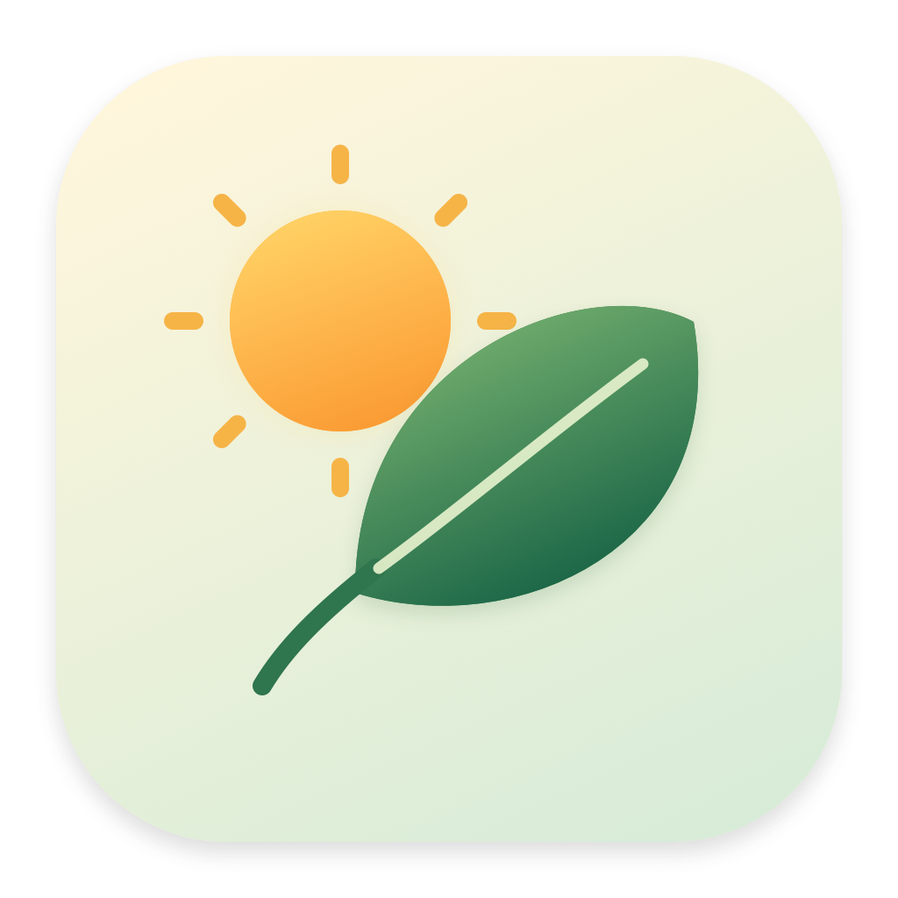
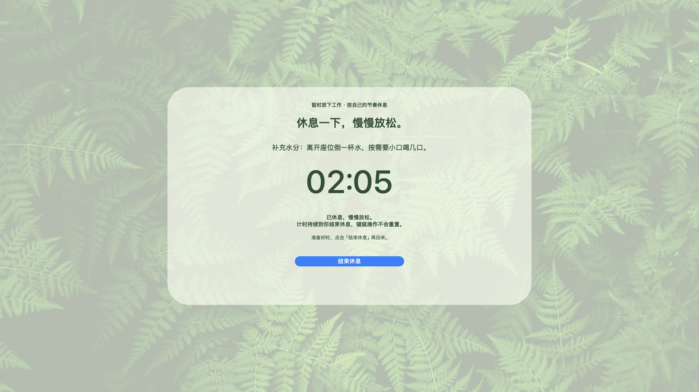
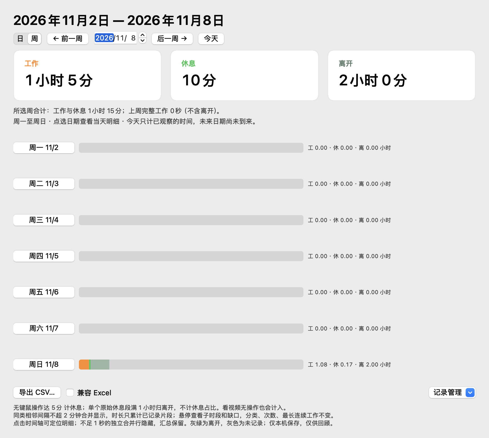

<p align="center">
  
</p>

# 歇一会儿 · RestReminder

**一个安静待在 macOS 菜单栏里的休息提醒工具。**

连续用电脑时，提醒自己停一停；想主动休息时，一键打开绿色全屏；一天结束后，回顾工作与休息的节奏。

使用 Swift 与 AppKit 编写，无第三方运行依赖。应用运行时不联网，无需账户，活动记录保存在本机。

源码：[GitHub 主仓库](https://github.com/xiongwhu/RestReminder) · [Gitee 源码镜像](https://gitee.com/dukexls/RestReminder)

[功能亮点](#功能亮点) · [快速开始](#快速开始) · [如何使用](#如何使用) · [隐私与权限](#隐私与权限) · [开发与文档](#开发与文档) · [关于我们](#关于我们) · [CPAL 许可与署名](#许可与品牌署名)



*界面示例使用模拟数据。图中的 02:05 表示已经休息 2 分 5 秒。*

## 功能亮点

| 功能 | 你可以做什么 |
| --- | --- |
| 菜单栏计时与提醒 | 查看本轮进度，自定义工作间隔和休息时长，到期后获得温和提醒 |
| 绿色全屏休息 | 接受提醒后立即进入倒计时休息；持续忽略提醒时逐步升级，并保留应急出口 |
| 主动休息正计时 | 从“现在就休息”随时开始，记录已休息时长，准备好后自己结束 |
| 休息建议与返回欢迎 | 轮换护眼、喝水、肩背、走动、呼吸、放松双手六类建议；休息后返回时显示约 2 秒暖色欢迎卡 |
| 音频与会议免打扰 | 有系统音频信号时暂缓自动提示；自动避让部分会议/演示场景，也可手动开启保护 |
| 日视图与周回顾 | 查看时间轴、时长占比、休息次数与最长连续工作；相邻同类明细自动合并展示 |
| 本地数据管理 | 导出 CSV；确认后删除日、周或全部记录；默认永久保留，可选择 30/90/365 天 |
| 原生 macOS 体验 | 不占用 Dock；设置自动保存，支持登录启动、单实例保护及明暗菜单栏图标 |

## 快速开始

首个公开源码版本为 **v1.0.0**，应用版本见 [VERSION](VERSION)，功能变化见[更新日志](CHANGELOG.md)。GitHub 主仓库与 Gitee 源码镜像均已公开，保留相同的版本标签。

本次先发布源码，不提供二进制试用发行。可按下方步骤自行构建；本机构建产物为 ad-hoc 签名，尚未完成 Developer ID 签名或 Apple 公证。

### 系统要求

| 项目 | 当前范围 |
| --- | --- |
| Apple Silicon 构建切片 | `arm64`，最低部署目标 macOS 12.0 |
| Intel 构建切片 | `x86_64`，最低部署目标 macOS 13.0 |
| 完整音频免打扰 | macOS 14.2+，需要系统音频录制授权 |
| 应用内一键登录启动 | macOS 13+；macOS 12 可从系统登录项手动添加 |
| 构建环境 | 可用的 Apple Command Line Tools 或 Xcode，以及支持所用 API 的 macOS SDK |

本地运行验证环境为 Apple Silicon / macOS 27。Intel 已完成交叉编译；macOS 12/13 及 Intel 实机体验仍待对应设备验收。部署目标与验证范围详见[技术设计](docs/design.md#102-兼容性事实)。

### 仓库与版本

| 平台 | 用途 | 仓库 |
| --- | --- | --- |
| GitHub | 主仓库、问题反馈、Pull Request 与 CI | [xiongwhu/RestReminder](https://github.com/xiongwhu/RestReminder) |
| Gitee | 同源源码镜像、备用克隆与下载入口 | [dukexls/RestReminder](https://gitee.com/dukexls/RestReminder) |

镜像由维护者同步 `main` 和版本标签；一次导入不等于自动同步服务。需要固定版本时，可在克隆后执行 `git checkout v1.0.0`；日常更新使用 `main`，核对版本时以同名标签和提交 SHA 为准。问题反馈和贡献优先提交到 [GitHub Issues](https://github.com/xiongwhu/RestReminder/issues) 与主仓库 Pull Request。

### 从源码构建

任选一个平台克隆，或从对应仓库页面下载源码 ZIP，在项目根目录运行：

```bash
# GitHub 主仓库
git clone https://github.com/xiongwhu/RestReminder.git
# 也可以把上一行替换为 Gitee 镜像：
# git clone https://gitee.com/dukexls/RestReminder.git
cd RestReminder
./build.sh
./build.sh --verify-only
open "build/歇一会儿.app"
```

构建脚本默认生成包含 Apple Silicon 与 Intel 的 Universal 应用，核对实际架构、最低系统版本及本地签名，无需打开 Xcode 工程。

首次启动会显示设置。修改工作间隔和休息时长后自动保存，关闭窗口即可继续后台计时。需要日常使用或开启登录启动时，建议先把应用复制到“应用程序”等固定位置，再检查权限和登录项状态。

也可以直接打开设置或记录窗口：

```bash
open "build/歇一会儿.app" --args --show-settings
open "build/歇一会儿.app" --args --show-history
```

## 如何使用

### 跟随提醒，完成一次连续休息

默认连续使用 **30 分钟**后提醒，连续 **2 分钟无键鼠操作**视为完成休息；这两个时间都能在设置中调整。阅读、思考等未达到休息阈值的短暂停顿仍计入本轮工作。

到期时，如果你正在闲置，应用会等恢复操作再提醒。提醒出现后：

- 选择 **“好，休息一下”**：立即进入绿色全屏，显示设定休息时长的倒计时。第一次提醒也能直接进入。
- 选择 **“5 分钟后提醒”**：延后 5 分钟再判断。连续三次正式提醒后仍未完成休息，下一次到期会进入加强休息。
- 确实需要继续处理事情时，可在全屏页使用 **“有急事，再给我 5 分钟”** 返回工作；未完成的提醒次数和应急期限会保留。

倒计时要求连续离开键鼠，新的输入会重启倒计时。普通点击、Escape 和关闭动作不会收起页面；应急出口和 macOS 正常系统快捷键保留。达到休息条件后收起全屏，恢复操作时欢迎并开始新一轮计时。

提醒出现前会先收起设置窗口，避免设置一起被带到前面。暖色欢迎卡和绿色建议卡不抢输入焦点，鼠标点击可以穿透。

### 现在就休息，按自己的节奏回来

从菜单栏选择 **“现在就休息”**，不必等到提醒时间。

| | 提醒后的休息 | 菜单主动休息 |
| --- | --- | --- |
| 显示内容 | 还需要连续休息多久 | 已经休息了多久 |
| 键鼠活动 | 重启连续休息倒计时 | 不重置正计时 |
| 结束方式 | 达到休息条件，或明确应急延后 | 点击页面或菜单的“结束休息” |

主动模式没有目标进度条，也不会到点自动关闭。锁屏或睡眠期间继续累计，返回桌面后恢复显示；主动结束后重开工作计时，历史中标注为“主动休息”。退出应用会关闭本次记录，重启不补记未运行期间。

主动入口不会增加正式提醒次数；已有未完成提醒仍按真实休息规则处理。暂停和免打扰开关会保留，它们控制自动提示，不会隐藏你主动打开的休息页。

### 听音乐、开会或演示时

音频免打扰根据系统输出的实际数字信号判断，声音结束后保留约 10–12 秒缓冲。播放期间仍继续记录，错过的欢迎不会在安静后补播。

会议自动避让覆盖摄像头/麦克风占用、显示器镜像，以及部分 Keynote / PowerPoint 全屏窗口信号。系统专注、任意共享屏幕、浏览器演示等场景无法保证自动识别，可从菜单 **“开启会议/演示免打扰”**，直到手动关闭。

音频能力不可用时会显示状态，基础计时继续工作。授权后可从“设置 → 预览与维护”重新连接。

### 回顾工作与休息

从菜单打开 **“工作与休息记录…”**：

- **日视图**：查看工作、短休息、离开总量与全天时间轴；点击色块定位明细。
- **周视图**：按周一至周日查看每天的节奏和合计；点击日期进入当天。
- **合并明细**：相邻同类、间隔不超过 2 分钟时显示为一行，例如“51分（4段）”；悬停查看原始子段和间隔。时长只加实际记录，不补计缺口，也不改变原始统计或 CSV。
- **数据管理**：导出所选日或周的 CSV，按需勾选 Excel 兼容；删除和启用有限保留期限前，都先预览并确认，默认取消。



工作为橙色，短休息为绿色。**单个原始休息段满 1 小时**会整体归为灰绿色“离开”，不参与工作/短休息占比；多段短休息合并显示后不会因此重新分类。原始 CSV 保留每段真实起止、类型和原因，包含被明细隐藏的亚秒记录。

这里反映的是设备活动和显式主动休息。看视频无操作也可能计入休息或离开，不能用来精确衡量劳动时间、工作效率或身体恢复情况。

[查看合并明细示例](docs/assets/history-merged.png) · [查看详细统计规则](docs/requirements.md#55-记录和历史口径fr-08fr-09)

## 隐私与权限

- **本机存储**：应用运行时不联网，不上传活动历史，不需要注册账户。
- **不采集输入内容**：只查询距最后一次输入经过的时间，不记录按键内容或鼠标轨迹。选择提示显示器时会瞬时读取指针位置，但不保存。
- **音频只做信号判断**：CoreAudio Process Tap 在内存中短暂读取系统输出样本，不保存音频文件、不识别语音、不上传，也不改变播放音量。
- **不打开摄像头或麦克风**：会议避让只读取可见占用与窗口尺寸等元数据，不建立捕获会话，不截取屏幕画面。

完整音频检测需要 macOS 系统音频录制权限；拒绝授权仍可使用基础计时与提醒。权限与信号限制见[技术设计](docs/design.md#6-音频免打扰设计)。

历史默认保存在当前账户的：

```text
~/Library/Application Support/RestReminder/activity-history.json
```

只保存时段起止、工作/休息类型与原因。常规保存带有检查点，异常退出可能丢失最近尚未保存的片段；应用未运行期间不补记。清理前可先导出备份，损坏档案会保留原文件并显示错误。

## 开发与文档

项目使用 Swift、AppKit、CoreGraphics、CoreAudio 和 ServiceManagement，无第三方运行库或测试框架。

```bash
# 运行十组隔离模型测试
./scripts/test.sh

# 校验文档、截图与本地链接（Python 3 标准库，无第三方依赖）
python3 scripts/check-docs.py

# 只运行指定套件
./scripts/test.sh history voluntary

# 仅构建当前芯片版本
ARCHS=native ./build.sh
```

重新构建前请先从菜单退出正在运行的应用；也可用 `BUILD_DIR` 指定独立产物目录，验证后再替换。

默认 Universal 构建分别探测可用部署目标，独立编译和链接每个架构，再合并验证。`SWIFTC`、`SDKROOT`、`DEVELOPER_DIR` 可指定工具链；更多选项见[构建与平台范围](docs/design.md#10-构建启动与平台范围)。

[GitHub Actions 配置](.github/workflows/tests.yml)包含模型测试、Universal 构建及部署/签名检查。首发只上传验证报告与校验信息，不上传应用 ZIP；工作流不创建发行记录。远程结果以 [Actions 页面](https://github.com/xiongwhu/RestReminder/actions)为准，本地验证与待验证平台见[验证说明](docs/design.md#9-测试设计与证据)。

- [更新日志](CHANGELOG.md)：应用版本与本次发布内容。
- [双平台发布流程](RELEASING.md)：候选材料、版本确认、GitHub/Gitee 同步与源码分发。
- [产品需求文档](docs/requirements.md)：完整功能、交互规则与验收边界。
- [技术设计文档](docs/design.md)：架构、两种休息模式、历史分组、测试及构建方式。
- [摄影素材说明](Resources/PHOTO-CREDITS.md)：图片来源与许可依据。
- [应用图标生成器](scripts/GenerateAppIcon.swift)：暖阳绿叶图标的原生绘制实现。

欢迎通过 Issues 反馈问题或提交 Pull Request。报告问题时，请提供 macOS 版本、芯片类型、复现步骤及预期行为；分享截图或记录前，请先移除个人信息。

## 关于我们

**迈润智人 RaCIO（广州迈润网络科技有限公司）** 专注企业 AI 落地。我们围绕 AI 超级分身、AI 超级员工和定制 AI 应用，提供场景诊断、原型验证、应用部署、团队工作坊与持续迭代，帮助企业把专家经验、组织知识和业务流程转化为团队可使用、可维护的 AI 能力。

了解我们的产品与业务：**[www.racio.chat](https://www.racio.chat)**。

应用内也可从“设置 → 关于歇一会儿”查看简短署名、版权与许可信息，点击官网按钮访问网站。[查看设置关于示例](docs/assets/about-settings.png)。

## 许可与品牌署名

本项目原创源码采用 **[Common Public Attribution License 1.0（CPAL-1.0）](LICENSE)**。完整条款及本项目的 Exhibit A / Exhibit B 以仓库中的许可证文件为准；允许的使用、修改与商业分发须遵守该协议的源码提供、声明保留和署名等义务。

### 品牌署名信息

Exhibit B 指定以下有限署名信息，署名要求同样适用于协议定义的 Larger Works：

| 项目 | 指定内容 |
| --- | --- |
| 版权声明 | Copyright (c) 2026 迈润智人 |
| 简短署名 | **RestReminder by RaCIO** |
| 官网链接 | **[https://www.racio.chat](https://www.racio.chat)** |
| 指定图形 | 无；不额外要求展示特定 Logo |

原版在 **“设置 → 关于歇一会儿”** 中提供品牌、版权和可点击官网。按 CPAL 第 14 条，继续使用原版的关于展示形式是满足署名要求的一种方式；有图形界面时还须遵守该条的合理显著性等限制，无图形界面访问时适用该条例外。不能删除适用署名，或以其他主体的署名使其不再具有协议要求的可见性。

该要求限于许可证指定的简短署名信息，不要求完整保留“关于我们”中的业务宣传段落。品牌标识的使用仍受 CPAL 第 14(d) 条及适用商标规则约束，不表示获得公司背书或通用商标授权。

### 源码与素材边界

CPAL-1.0 不是“只保留署名即可任意闭源分发”的许可。受覆盖代码及修改的源码提供义务依第 3 条执行；外部部署（包括适用的网络使用）依第 15 条处理。组合成更大作品不免除其中受覆盖代码的许可义务，具体范围以正文为准。

第三方摄影素材继续遵循[各自来源许可](Resources/PHOTO-CREDITS.md)，不被本项目重新授权为 CPAL。应用图标为项目原创，图标生成源码随项目源码许可；公司品牌与第三方素材的权利应分别核对。

### 发布状态

本次公开源码与版本标签，暂不发布二进制试用包。目标设备验收、正式签名公证及未来下载包以项目后续发布说明为准；源码使用按本仓库 CPAL-1.0 条款执行。
