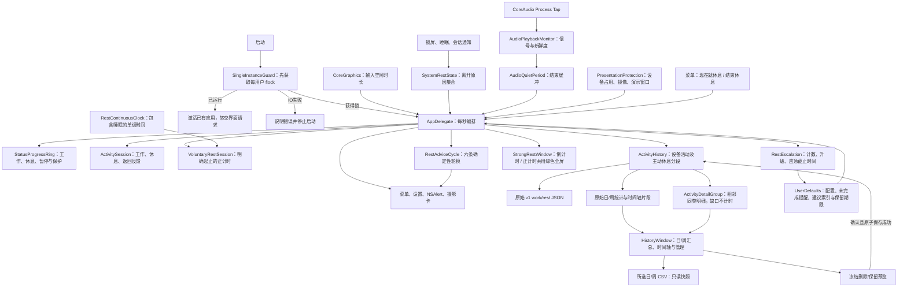
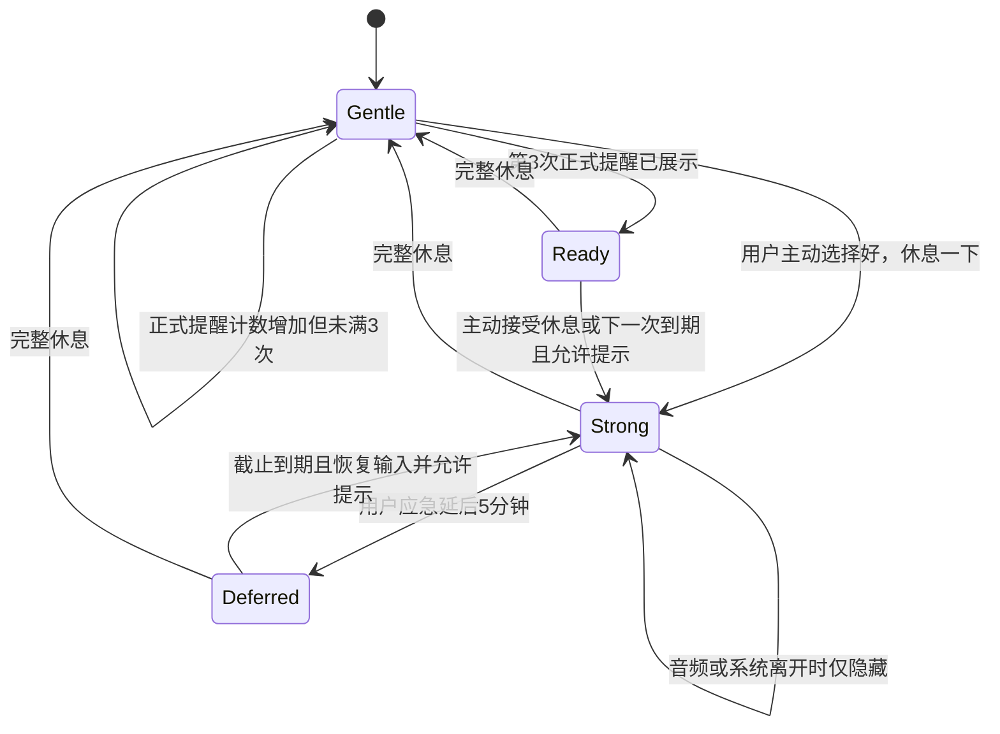
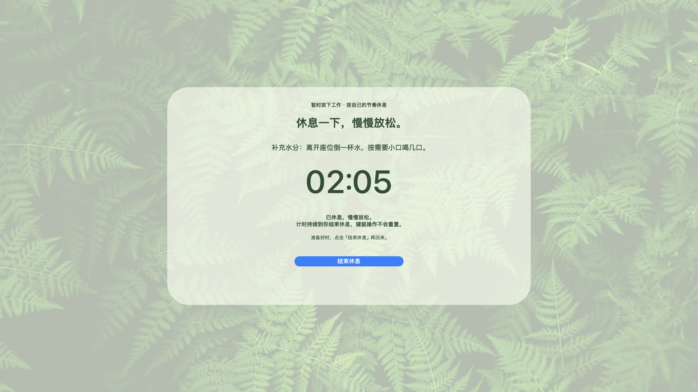
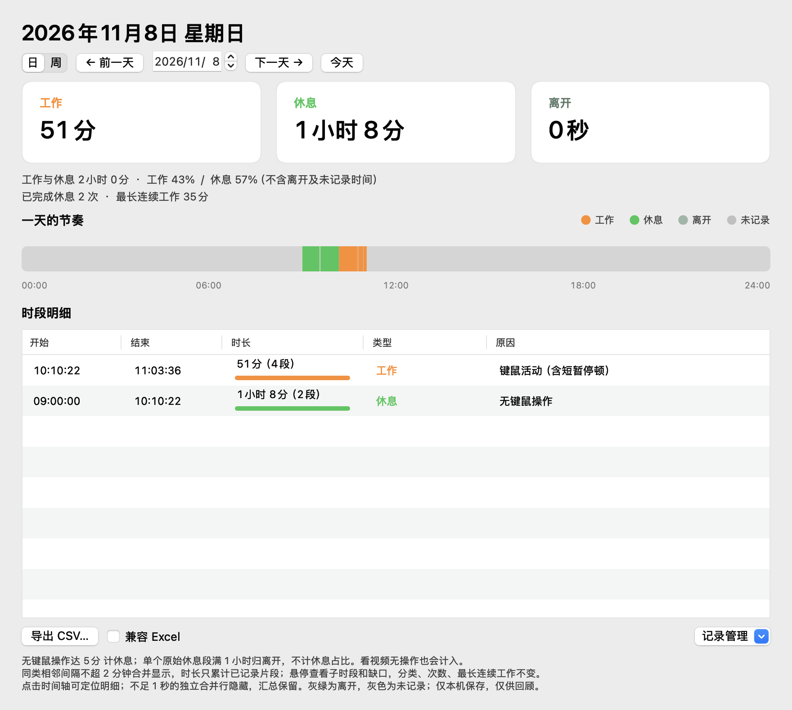

# 歇一会儿 · 技术设计文档

| 项目 | 内容 |
| --- | --- |
| 对应产品 | 歇一会儿 / RestReminder |
| 版本与日期 | v1.4，2026-11-09；覆盖截至本次核对的已实现功能，不代表已发布安装包版本 |
| 本次核对 | 2026-11-09（Asia/Shanghai），对照当前源码、模型测试与原生界面检查 |
| 关联需求 | [产品需求文档](requirements.md) |
| 文档性质 | 按现有代码整理的实现设计，包含验证证据、限制与公开发布准备 |
| 面向读者 | 接手维护、学习实现、提交贡献的开发者，以及技术文章作者 |

本文按当前实现统一说明从工作提醒、主动休息到历史回顾的完整行为。v1.3 在原有六类建议、正式图标、日/周历史与数据管理、单实例及 Universal 构建基础上，纳入提醒按钮直接开启全屏、约 2 秒欢迎卡、提醒不带起设置窗口、菜单主动休息正计时，以及相邻同类明细合并。

“已经实现”“本地已验证”和“仍需真实平台验收”分别标注。2026-11-09 的十组本地模型测试、相关增量回归、原生界面检查及 Universal 部署目标/签名校验已有通过记录；GitHub Actions 已编写并本地解析，尚未远程执行。在新系统执行旧部署目标程序或交叉编译，不等同于旧 macOS 和 Intel 实机验收。

## 阅读导航

[功能索引](#当前已实现功能索引) · [架构](#1-设计概览) · [主循环](#2-主循环与优先级) · [模式对照](#34-两种绿色全屏模式) · [三次升级](#4-三次提醒与加强休息策略) · [系统离开](#5-锁屏睡眠和重叠通知) · [音频](#6-音频免打扰设计) · [历史合并](#同类明细合并展示fr-30) · [设置与展示](#8-设置登录项与展示设计) · [主动休息](#87-菜单主动休息与正计时) · [界面示例](#88-当前界面示例) · [测试](#9-测试设计与证据) · [构建](#10-构建启动与平台范围) · [开源边界](#11-素材隐私与开源仓库边界) · [决策](#12-关键设计决策及替代方案) · [待确认](#131-已讨论但未实现的方案)

## 当前已实现功能索引

需求编号沿用[产品需求文档](requirements.md)。以下索引对应当前代码，不将待确认方案算作已交付功能。

| 功能范围 | 当前行为 | 需求编号 | 设计位置 |
| --- | --- | --- | --- |
| 常驻菜单、状态环与设置 | 显示工作/休息/暂停/保护状态；自动保存时间设置；预览维护折叠；可暂停和重新计时 | FR-01、FR-10、FR-12、FR-13、FR-20 | [设置与展示](#8-设置登录项与展示设计) |
| 普通计时与返回反馈 | 连续工作到期；系统空闲/锁屏/睡眠判断休息；返回欢迎约 2 秒，休息不足可显示绿色建议卡 | FR-02、FR-04、FR-05、FR-07 | [工作与休息状态](#3-工作与休息状态设计)、[系统离开](#5-锁屏睡眠和重叠通知) |
| 提醒与倒计时全屏 | 正式提醒中接受休息立即进绿色全屏，不补齐次数；持续忽略三次后下次到期自动升级；保留应急出口与独立恢复期限 | FR-03、FR-14、FR-15、FR-16 | [提醒与升级](#4-三次提醒与加强休息策略) |
| 主动正计时休息 | 菜单“现在就休息”直接进绿色全屏，显示已休息时长，直到“结束休息” | FR-29 | [主动休息](#87-菜单主动休息与正计时) |
| 关于与品牌署名 | 设置保留简短署名、迈润智人版权和官网按钮，署名与 CPAL Exhibit B 一致 | FR-31 | [关于入口](#89-设置关于与品牌入口fr-31) |
| 自动免打扰 | 实际音频信号、部分会议/演示信号与手动保护；覆盖不完整时如实提示 | FR-06、FR-19 | [音频与会议保护](#6-音频免打扰设计) |
| 建议和图标 | 六类建议确定性轮换、预览独立；原创暖阳绿叶应用图标 | FR-21、FR-22 | [建议轮换](#86-六条轮换建议)、[原创图标](#112-原创应用图标) |
| 日历史与合并明细 | 本地工作/休息记录、长离开分类、汇总及时间轴；同类相邻间隔不超 2 分钟合并显示，保留真实子段与缺口 | FR-08、FR-09、FR-30 | [日汇总与明细](#74-日汇总与呈现) |
| 周回顾与定位 | 周一至周日的堆叠条、合计和上周参考；日期下钻、时间轴成员定位合并行 | FR-23、FR-25 | [周视图与定位](#75-周视图与时间轴定位) |
| 数据管理 | 原始 CSV、Excel 可选 BOM、删除日/周/全部前确认、默认永久保留及可选期限 | FR-24 | [CSV](#76-csv-契约)、[删除与保留](#77-删除预览与原子提交) |
| 登录启动 | 支持系统登录项状态、批准提示；macOS 12 提供手动设置入口 | FR-11 | [登录自启动](#82-登录自启动) |
| 构建、单实例与自动检查 | ARM12/Intel13 实际部署目标、生命周期锁、十组本地模型测试及 CI 配置 | FR-26、FR-27、FR-28 | [测试](#9-测试设计与证据)、[构建与平台](#10-构建启动与平台范围) |
| 文档和本机构建产物 | 已有需求、技术设计、模拟界面和本地 ad-hoc 构建；正式开源及签名公证仍是发布准备 | FR-17、FR-18 | [公开边界](#11-素材隐私与开源仓库边界) |

## 1. 设计概览

这是一个通过每用户生命周期锁保持单写入实例、无服务端的原生 macOS 应用。AppKit 负责菜单和窗口，CoreGraphics 提供全会话空闲时长，macOS 14.2+ 的 CoreAudio Process Tap 提供短暂音频样本以判断信号，macOS 13+ 的 ServiceManagement 处理应用内登录项注册；macOS 12 提供手动登录项入口。业务规则与窗口展示分离，历史记录独立于提醒计时。

程序采用 accessory 激活策略，清单设置 `LSUIElement=true`，常驻菜单栏而不常驻 Dock。没有第三方运行库、账户系统、云端同步或运行时图片下载。

### 1.1 组件与数据流



CoreAudio 回调位于音频线程；AppKit、规则编排、历史查看等在主线程使用。回调只计算信号并更新少量加锁的时间戳，不把音频缓冲区交给历史或 UI。

### 1.2 源码职责

应用显式编译以下 **15 个 Swift 源文件**；图标生成器和测试程序不计入应用源码列表。

| 文件 | 主要职责 |
| --- | --- |
| [应用入口](../Sources/main.swift) | 启动锁、AppDelegate、每秒 tick、菜单/设置、登录项、建议索引及通知编排 |
| [计时状态](../Sources/ActivitySession.swift) | 工作起点、普通延后、休息完成、返回反馈；包含 SystemRestState |
| [主动休息](../Sources/VoluntaryRest.swift) | 明确开始/结束与单调正计时，不依赖键鼠空闲，不恢复退出期间 |
| [升级策略](../Sources/RestEscalation.swift) | 正式提醒计数、加强状态、连续空闲、系统离开及应急期限 |
| [音频检测](../Sources/AudioPlaybackMonitor.swift) | Tap、私有聚合设备、信号强度、新鲜度及音频结束缓冲 |
| [历史模型](../Sources/ActivityHistory.swift) | 原始分段、JSON、日/周汇总、纯展示明细分组、CSV、删除预览、原子提交及保留策略 |
| [历史窗口](../Sources/HistoryWindow.swift) | 日/周切换、七日条形、合并行及子段悬停、时间轴成员定位、导出与记录管理 |
| [摄影反馈](../Sources/ReturnCelebration.swift) | 非激活、点击穿透的欢迎/绿色建议卡及摄影动画 |
| [全屏休息窗口](../Sources/StrongRestWindow.swift) | 各屏绿色页、固定建议、倒计时/正计时模式、应急/结束双回调及恢复焦点 |
| [会议保护](../Sources/PresentationProtection.swift) | 设备占用、镜像、演示窗口元数据、覆盖边界及 3 秒缓存 |
| [进度环](../Sources/StatusProgressRing.swift) | 工作/休息比例、暂停/盾牌状态及原生模板图标 |
| [轮换建议](../Sources/RestAdvice.swift) | 六条建议数据与确定性 RestAdviceCycle |
| [单实例保护](../Sources/SingleInstanceGuard.swift) | 生命周期 flock、IO/占用区分、允许名单内界面请求 |
| [连续时钟兼容层](../Sources/RestContinuousClock.swift) | macOS 12 可用、包含睡眠的单调时长计算 |
| [关于与设置滚动布局](../Sources/AboutBrandView.swift) | 公司品牌、CPAL 署名、仅点击打开官网；可变高内容与小屏幕滚动 |

## 2. 主循环与优先级

以下普通计时和自动升级流程之外，菜单主动休息在历史采样后优先处理：继续正计时及明确 rest 归档，按系统离开隐藏/重显，然后返回；不让普通采样、欢迎反馈或自动倒计时覆盖这个由用户开启的页面。

### 2.1 输入契约

每秒通过 `CGEventSource.secondsSinceLastEventType` 查询 combined session 的所有事件类型空闲值。活动监测获取的是“距最后输入经过多久”，不采集按键内容或鼠标轨迹。窗口定位会瞬时读取当前指针位置，以选择提示所在显示器或键盘焦点所在屏幕；该位置不写入历史。

`ActivitySession.sample` 输入单调运行时间、空闲秒数、工作间隔、休息阈值和是否抑制提醒，输出是否正式到期，并通过 `feedback` 提供欢迎或休息建议。

`RestEscalation` 输入已展示正式提醒、完整休息、系统离开/返回及应急操作，决定下一次到期的动作。它不负责创建窗口。

### 2.2 tick 的实际顺序

1. 获取音频、会议/演示信号与手动保护，合成 `suppress`；自动音频与会议各有结束缓冲。进入保护时收起摄影卡，中止自动模态提醒。这控制自动提示，不撤销用户主动打开的正计时页。
2. 获取输入空闲值，调用 `history.sample`。历史独立于提醒；主动态已建立显式 rest 区间，键鼠活动不会把它改记为工作。
3. 若主动休息正在运行，优先处理：用单调时钟更新已休息时长；以 `min(idle, 主动经过时长)` 检查旧升级义务是否真正完成；系统离开时隐藏，否则显示正计时全屏，然后返回。不因休息阈值、音频或暂停自动结束主动态。
4. 其余模式判断是否完整休息；达标则清零并保存升级状态，告知普通计时模型，收起倒计时全屏和自动模态提醒。
5. 系统仍处于离开状态时隐藏全屏并返回。
6. 普通模态提醒尚未结束时返回；此前的保护、历史及真实休息判断仍已执行。
7. 采样普通工作计时；如存在独立应急截止，优先采用该日期判断是否恢复倒计时休息。
8. 已处于倒计时休息时，根据保护/暂停隐藏或展示全屏，然后返回。
9. 展示允许的正常返回反馈，更新菜单中的暂停、保护、应急延后或工作状态。
10. 正式到期且可提示时，根据 `nextAction` 选择普通提醒或倒计时全屏；此前已存在未完成截止标记时，不能仅凭计数未满三次就重弹普通提醒。
11. 任一分支返回均通过 `defer` 更新菜单栏图标。主动态优先显示不代表目标进度的叶子及已休息时长；其余模式按工作、休息、暂停和保护规则绘制。

Timer 注册在主 RunLoop 的 common 模式。这个顺序的重要性在于：模态提醒存在时，仍有路径确认真实休息并关闭过期提醒；音频免打扰也不会阻断本地记录。

### 2.3 三种时间来源

| 时间来源 | 用途 | 设计考虑 |
| --- | --- | --- |
| `ProcessInfo.systemUptime` | 普通工作间隔、普通延后、采样间隔、音频结束缓冲 | 避免普通墙钟修改直接影响工作计时 |
| `RestContinuousClock` | 音频新鲜度、会议元数据缓存与主动休息正计时 | 基于 `mach_continuous_time`，包含睡眠；macOS 12 可用，`duration(to:)` 返回 Double 秒 |
| `Date` | 历史起止、系统休息、持久化应急截止、加强休息进入时刻 | 可跨睡眠、跨进程保存；系统时钟改动会影响相关墙钟判断 |

这不是统一单时钟系统。尤其应急截止使用墙钟，当前没有针对手动改时间的双时钟校准，见第 13 节。

## 3. 工作与休息状态设计

### 3.1 ActivitySession

主要状态包括 `startedAt`、`deferredUntil`、`paused`、前次采样/输入信息、`completedRest`、`awaitingRest`、休息建议冷却及系统返回待处理标志。

| 条件或事件 | 处理 |
| --- | --- |
| 启动后已有很长空闲 | 等待新鲜活动，不计入一轮历史工作，也不直接欢迎 |
| 空闲不超过 2 秒 | 可作为开始本轮或正式提醒的时机 |
| 空闲达到休息阈值 | 清工作起点与普通延后，保留已确认休息，等待返回 |
| 输入时间相对前次前进超过 0.05 秒 | 判断发生了恢复操作 |
| 完整休息后恢复操作 | 产生一次 `welcomeBack`，本轮从现在开始 |
| 到期/已接受休息后，短暂离开又返回 | 可产生 `needsMoreRest`，冷却 30 秒，并为卡片阅读至少让出 30 秒 |
| 正式提醒中“好，休息一下” | `beginRest` 后立即走共享 `beginFullScreenRest`，开启绿色页并保留当前计数与建议；不直接标记完成，预览不改变真实状态 |
| 普通“5 分钟后提醒” | 基于 uptime 的 300 秒延后 |
| 暂停、重新计时、有效配置改变 | 重置普通工作模型；历史与累计正式提醒独立保留 |
| 无效 idle 或超过 10 秒的采样间隔 | 重置不可信的工作计时；长间隔路径保留已确认的休息/系统返回标志 |

休息建议要求上一轮空闲至少达到 `min(5 秒, 休息阈值 / 2)`，避免每次停顿都提示。

### 3.2 模态期间完成休息

主循环可以在模态提醒尚未关闭时观察到完整空闲。`acknowledgeCompletedRest` 清除工作和普通延后，设置已休息标志及新的采样锚点，但保留匹配的系统离开起点。随后自动模态被中止，恢复操作时仍可欢迎；锁屏返回时也保留 Touch ID 的触发路径。

### 3.3 返回反馈与音频

音频抑制下，反馈被消费而不排队。这样视频播放期间达成休息后，不会在视频结束时突然补一张过期欢迎卡。手动预览属于显式操作，可以越过自动提示的抑制条件。

### 3.4 两种绿色全屏模式

两种模式共用摄影背景、各显示器窗口和焦点恢复机制，计时和结束条件分别由业务状态决定。正式提醒中的“好，休息一下”属于倒计时入口；菜单“现在就休息”属于正计时入口。

| 对照项 | 提醒后的倒计时休息 | 菜单主动正计时休息 |
| --- | --- | --- |
| 入口 | 任意一次正式提醒选择“好，休息一下”；或持续忽略三次后的下一次到期 | 菜单“现在就休息” |
| 屏幕数值 | 当前休息阈值的剩余时间及进度 | 从 00:00 增长的已休息时长；满一小时显示时分秒，无目标进度条 |
| 键鼠活动 | 重启连续空闲倒计时 | 不重置主动经过时长 |
| 结束条件 | 实际连续空闲/系统离开达标；或点应急按钮暂缓 | 点击页面或菜单的“结束休息”；不按阈值自动结束 |
| 暂停、音频及会议保护 | 暂时隐藏自动倒计时页 | 保留用户明确开启的页面，原保护开关不改变 |
| 锁屏、睡眠、会话离开 | 隐藏页面；足够长的实际休息可解除本轮 | 隐藏页面但持续累计；返回桌面继续，保留同一主动历史区间 |
| 正式提醒次数 | 只保留实际已展示次数；接受第一、二次不补成第三次 | 不增加次数；旧义务仍按真实休息规则判断 |
| 历史来源 | 独立的输入空闲/系统事件分段，不把画面剩余秒数当记录 | 显式开始到结束的 rest 区间，原因“主动休息” |
| 重启 | 恢复未完成计数与独立截止，不恢复旧窗口/逐秒状态 | 不恢复主动计时，不补记应用未运行期间 |

结束主动态会重开普通工作计时；如果还存在未完成的倒计时休息或应急义务，仍由原规则判断是否继续，不能把一次短暂主动休息当作已经完成旧义务。

## 4. 三次提醒与加强休息策略

### 4.1 计数与状态

计数只在真正调用自动普通提醒展示时增加，上限为 3。手动预览、绿色建议和菜单主动休息均不增加。第一次部署该功能后，不追算旧版本已经弹过的提醒。以下状态图只描述正式提醒与倒计时义务；主动正计时由独立模型管理，见[模式对照](#34-两种绿色全屏模式)。



`Ready` 是由计数推导的业务状态，不是代码中的独立枚举。用户主动接受休息会直接进入同一绿色页，不补齐到三次。`nextAction` 在存在未完成全屏休息的截止标记或计数已满三次时为全屏，否则为普通提醒；截止是否到期仍由独立日期及输入/保护条件判断。

### 4.2 连续休息与倒计时

加强休息进入时保存 `strongRestStartedAt` 和当时可知的工作时长。展示用剩余时间为：

```text
elapsed = max(0, 当前墙钟 - 进入时刻)
remaining = max(0, 休息阈值 - min(当前idle, elapsed))
```

视图仅展示数值。完成由主循环观察全局 idle 达标，或由系统离开/返回确认足够长休息。新的键鼠输入使 idle 回到零，连续休息重新计时。音频或锁屏导致页面隐藏，不等于清除未完成状态。

### 4.3 应急期限独立于工作计时

应急按钮执行以下动作：

1. 结束当前全屏展示状态，保留实际计数（主动接受时可为 1 或 2，自动升级时为 3）。
2. 设置 `emergencyDueAt = Date() + 300 秒` 并持久化。
3. 收起各屏窗口，尝试恢复原工作应用焦点。
4. 同时设置普通计时模型的 300 秒延后。

后续主循环优先检查独立日期。即使短锁屏、普通计时重置或长采样间隔清除了 `ActivitySession.deferredUntil`，应急截止仍在。截止到达以后，还须系统已返回、未暂停、没有音频抑制，且有新鲜输入，才恢复加强休息。

### 4.4 保存与恢复

`saveEscalation` 保存计数及 `strongRestDueAt`。如果正在全屏休息（主动接受或自动升级），保存“现在”作为已经到期的标记；如果在应急延后，保存未来截止；完成整次休息后删除截止并清零。

重新启动时，计数夹在 0–3；只要有真实提醒计数就保留截止时间，使第一次或第二次主动接受的休息也能继续，计数为 0 的孤立旧标记则忽略。恢复的是未完成义务与期限，不是旧窗口、旧工作起点或逐秒倒计时。恢复输入时可重新进入加强休息，未知工作分钟数不会被伪造为此前的实际工作量。

普通工作起点、普通延后、暂停和主动正计时起点均不跨进程恢复。正常退出时历史关闭当时已记录的区间；再次启动只载入已保存记录，不续写应用未运行期间。持久化应急期限与计数因此具有独立于这些进程内状态的恢复语义。

## 5. 锁屏、睡眠和重叠通知

`SystemRestState` 使用原因集合：`screenLock`、`sleep`、`inactiveSession`。

- 集合由空变为非空：只发一次离开。
- 重复离开或重复恢复通知：不重复转换。
- 集合由非空变为空：只发一次最终返回。

输入来自 `NSWorkspace` 睡眠/唤醒、会话离开/恢复，以及 `DistributedNotificationCenter` 的 `com.apple.screenIsLocked`、`com.apple.screenIsUnlocked` 字符串通知。

离开时挂起历史、普通计时和升级策略，隐藏摄影卡、模态与全屏页。原因集合最终清空时，普通模式恢复历史并按墙钟判断系统休息；若主动正计时仍运行，则跳过 `history.resume`，保留同一个显式 rest 区间。主动时长用包含睡眠的单调时钟继续累计，返回后不会被普通欢迎或倒计时覆盖。两条路径都清除睡前音频和会议结束缓冲，再执行 tick，详见[主动休息](#87-菜单主动休息与正计时)。

`ActivitySession` 用系统离开经过时长和此前已确认的休息，设置 `systemReturnPending`。该标志使解锁本身可以触发一次欢迎，即使 Touch ID 尚未让 idle 归零。

需要注意三个模型的口径：升级策略会把锁定前已空闲的时长纳入系统休息判断；普通返回模型主要依据系统离开时间与此前已确认休息；历史若当时仍是工作，则从系统离开时刻转为休息。它们服务不同用途，不能宣称边界在所有情形都完全一致。

当前没有在通知丢失后主动查询系统锁定状态的纠偏机制；字符串通知在不同系统版本上的行为属于发布前人工验收项目。

## 6. 音频免打扰设计

### 6.1 为什么检测样本而不是输出流

初版依据音频进程是否运行输出流，会被系统语音服务、WebKit 或驱动维持的静音流误导。最终采用系统音频 Tap 计算短暂样本的信号强度。

此方案需要 macOS 14.2+ 及系统音频录制授权。它不会使用麦克风，不录制屏幕画面，但会在内存中短暂读取音频样本，因此不能写成“完全不接触音频数据”或“不需要录音类权限”。

### 6.2 资源与线程

- 使用排除列表为空的全局立体声 `CATapDescription`，Tap 为 private、unmuted。
- 创建私有临时聚合设备，把 Tap 接入音频回调；不改变正常播放音频。
- 当前实现接受 32 位 Float linear PCM。初始化失败清理设备、回调和 Tap，保留错误说明。
- 回调遍历缓冲区计算能量与峰值，只保存最后声音、最后缓冲区等 `RestContinuousClock` 时间戳，用锁与主线程交换。
- 不保存缓冲区、不生成音频文件、不识别语音、不上传。

### 6.3 信号和新鲜度

| 参数 | 当前实现 |
| --- | --- |
| 有声判定 | 均方能量 ≥ `1e-8`，**或**绝对峰值 ≥ `0.0003` |
| 均方阈值解释 | 对应 RMS 约 `1e-4`，即约 -80 dBFS |
| 声音新鲜度 | 最近有声样本距现在小于 1.5 秒，视为 playing |
| 缓冲区失效 | 距最后非空缓冲区超过 3 秒，视为 unavailable；启动无数据最初约 3 秒可暂为 silent |
| 结束缓冲 | 只有 playing 续 `now + 10 秒`；silent/unavailable 不续期 |

结束后体感抑制常约 10–12 秒，来自新鲜度窗口和结束缓冲叠加。unavailable 只保留已有缓冲，不会永久续期。

数字信号不是最终扬声器声压，硬件静音或设备最终音量并不一定体现在 Tap 样本里。音乐也会触发免打扰；当前没有按内容识别“这是视频”。

### 6.4 降级与恢复

功能不支持、无权限、回调无数据或其他失败会进入 unavailable 并显示不可用状态；初始化失败还可提供具体错误说明，回调长期无数据时可能只有通用状态提示。该状态不能精确证明一定是用户拒绝权限。基础计时继续工作；用户可在设置中手动重连，当前没有周期自动重试。

### 6.5 会议/演示保护与识别边界：FR-19

[会议保护模块](../Sources/PresentationProtection.swift) 在主线程每 3 秒最多采样一次，使用 RestContinuousClock 缓存。它只读 AVFoundation 可见摄像头/麦克风的连接和占用状态、CoreGraphics 镜像显示器信息；仅当前台是已核实的 Keynote / PowerPoint bundle ID 时，读取窗口 PID、layer、alpha、bounds，与显示器边界进行 2 点容差比较。排除本应用，不打开设备、创建捕获会话、申请设备权限、读取窗口标题或截取像素。

设备未报告占用并不能证明不存在会议；无设备占用的会议、浏览器放映、任意应用屏幕共享可能没有自动信号；演示应用的满屏编辑窗口也可能被保守保护。`unavailable` 描述覆盖范围，不能作为已经保护的依据。当前 ad-hoc 工具不调用 Focus API；[Apple 官方说明](https://developer.apple.com/documentation/usernotifications/handling-communication-notifications-and-focus-status-updates)还涉及通信通知能力、相关授权及应用视角状态，不能直接承诺跟随全局勿扰。

主菜单提供手动会议/演示开关，持续到用户关闭并跨重启保留；设置可关闭自动避让。音频缓冲、手动保护和自动信号结束缓冲三者取或，控制自动反馈、正式模态和倒计时休息页。自动信号每次续 10 秒，系统最终返回时清旧缓冲并重采样。保护本身不重置工作计时、不改历史、不清提醒次数，真正完成休息仍可清零。

菜单“现在就休息”是明确用户操作，可在这些保护或暂停状态下开启正计时；保护开关继续保留，但不会收起该页面。系统锁屏/睡眠仍会隐藏页面，主动时间继续累计。

## 7. 本地历史与统计

### 7.1 数据结构与存储

核心结构：

```swift
struct ActivityRecord: Codable {
    var start: Date
    var end: Date
    var kind: ActivityKind // work 或 rest
    var reason: String
}
```

归档为版本 1 的对象，包含 `version` 与 `records`；日期编码为 Unix epoch 毫秒。默认位置由当前账户的 Application Support 目录构造：

```text
~/Library/Application Support/RestReminder/activity-history.json
```

示意结构如下，数值仅用于展示格式，不取自任何真实历史：

```json
{
  "version": 1,
  "records": [
    {"start": 1800000000000, "end": 1800000060000, "kind": "work", "reason": "示例工作"},
    {"start": 1800000060000, "end": 1800000360000, "kind": "rest", "reason": "示例休息"}
  ]
}
```

### 7.2 分段与恢复

- 短 idle 暂时算作工作；达到休息阈值后回溯到最后输入，但不早于当前已观测边界。
- 系统离开立即转入休息，不需要先等待阈值；已有休息保留原起点。
- 菜单主动开始时以显式点击的 idle=0 收束原片段，再以“主动休息”建立显式 rest；键鼠和锁屏/睡眠不切回工作，只有主动结束才恢复普通采样并创建新工作边界。
- 无系统通知且采样间隔超过 10 秒时，在最后可靠采样点关段，中间留空。
- 启动加载检查点时把已保存区间视为关闭，不把停机时段续写成活动。
- 常规采样拒绝产生早于已有记录末端或上次采样的重叠；这不是对任意墙钟异常的完整修复。

### 7.3 保存与失败

状态变化、系统离开/返回、退出及约 30 秒检查点会原子重写整份归档。异常退出可能丢失最近尚未保存的部分；写入失败会报告并在后续保存机会重试。

加载要求版本正确、时间有限、`end > start`，且按顺序不重叠。JSON 损坏、未知类型、版本不支持或区间无效会使整份加载失败：保留原文件，本次运行只记内存，界面显示错误；不会自动修复或覆盖。

v1.2 已加入 CSV、删除/保留预览和每用户单实例锁，见下文。归档仍整份读取及原子重写，没有压缩或按文件分段加载；默认永久保留时，长期数据规模与写入成本仍需测量。

### 7.4 日汇总与呈现

日汇总使用派生展示类型 `ActivityDisplayKind.work/rest/away` 与 `ActivityDay.displayIntervals/awaySeconds/completedRestCount/longestWorkSeconds`。先按完整原始 rest 段是否达到 3600 秒分类，再裁剪到日范围；整段达到 1 小时全部算离开，不拆成第一小时休息。进行中的段达到 1 小时会整体变为离开；旧 v1 档案按查看时派生分类，原始 `ActivityKind` 仍仅 work/rest，归档无需迁移。

工作/短休息分母排除离开，离开单独汇总并以灰绿色展示；文字使用适配明暗外观的更深/更浅灰绿保证可读。已完成休息次数要求关闭段、完整长度达到当前阈值且不足 1 小时，按本地结束日期计数；刚好午夜结束归新一天，进行中不计。最长工作取当天裁剪后的单段最大值，包含已观测的进行中工作，不跨休息或空白合并。

不足 1 秒的正数片段从时间轴 `displayIntervals` 隐藏，原始区间与汇总保留这些时间。明细另用 `ActivityDay.detailGroups`：先对所有正数、已按完整原始段分类的片段分组，再隐藏累计不足 1 秒的组；细小的异类片段仍阻止跨类型合并，同类亚秒片段则保留在累计时长中。长离开不显示绿色休息阈值条，也不参与短休息条形比例尺。

历史窗口以 `NSColor.systemOrange` 表示工作、`NSColor.systemGreen` 表示休息；汇总标题、图例、时间轴、明细类型及无障碍说明统一对应，未记录保持灰色。这与太阳欢迎和植物休息摄影形成一致的颜色含义。

时长列使用独立 `HistoryDurationCell`，保留时长文字；仅在实际秒数严格大于当前类型阈值时绘制底部横条。工作阈值通过 `workInterval` 闭包读取，休息通过 `restThreshold` 读取；每天刷新时按类型求 `scale = max(阈值, 当天同类最长展示组的真实累计时长, 1)`，填充比例为 `duration / scale`，最小可见宽度为 2 点。两种类型分别归一化，适合比较同类型时段，不把不同阈值误当同一量尺；悬停说明比例含义。配置变化与进行中时长在下次 5 秒刷新时重新计算，数据存储和统计口径不变。

`day` 按 Calendar 的真实本地日范围裁剪区间；时间轴按该日实际长度缩放，不写死 86,400 秒，因此算法可适配夏令时 23/25 小时日。现有测试已覆盖 23/25 小时日。

工作比例为 `work / (work + rest)`，未记录的全天空白不参与分母。明细按开始时间降序，进行中区间有标识。窗口可见且未最小化时每 5 秒刷新。记录窗口通过局部 `performKeyEquivalent` 响应 Command+W，调用标准 `performClose`；关闭时原窗口代理停止刷新，后台提醒继续，且可以重新打开。明细只显示 `HH:mm:ss`，夏令时回拨的重复小时仍可能有显示歧义。

#### 同类明细合并展示（FR-30）

`ActivityDetailGroup.grouped(_:maximumGap:calendar:)` 默认使用 120 秒的逐段间隔上限，只合并同一本地日、相同展示类型、无异类片段穿插的相邻记录；重叠/损坏片段作为屏障，非有限时间保守阻止合并。不同原因按首次顺序去重保留。

每组 `duration` 是成员已记录时长之和，`gapDuration` 是起止跨度减去真实时长。界面标注段数，悬停列出原始子片段和缺口；色条按同类最长展示组的真实累计时长缩放。多个短休息即使合计超过一小时仍为休息，最长连续工作、完成次数与原始日/周汇总不因展示分组而改变。

时间轴继续使用原始 `displayIntervals`，不把空白涂满；点击成员经 `contains` 定位合并行，刷新选中项按原始成员起点恢复。进行中标志检查组内成员，兼容当前亚秒成员本身没有时间轴色块的情况。原始 JSON、CSV、删除/保留预览完全不使用合并行。

### 7.5 周视图与时间轴定位

`ActivityHistory.week` 固定计算所选日期所在的周一至周日，不受地区默认每周首日影响。七个 `ActivityWeekDay` 分别持有 Calendar 生成的真实日范围、日汇总及 past/partial/future 状态；周总量对七日日汇总求和，跨夏令时不会假设每天 86,400 秒。

历史窗口使用七个原生日控件绘制工作、短休息、离开的堆叠条，保留相同颜色语义。当前周显示“截至目前”，今天只展示已观察部分，未来日明确标记；前一周完整工作总量作为上下文，不把部分本周伪装成同口径增长率。点击日期下钻到日视图；点击日时间轴时段，会选中并滚动到倒序明细中的对应行，未记录空白不伪造行。

### 7.6 CSV 契约

`csv(in:now:calendar:includeBOM:)` 对整个所选日或周生成只读快照，而非只导出可见/选中的行。输出所有正数时长片段，包含被明细隐藏的亚秒记录；裁剪到选择范围与 `now`，不导出未来或填补空白。列为 `start,end,duration_seconds,category,reason,ongoing`，类型仍按完整源记录派生；进行中标志描述源记录。

时间戳为带六位微秒与时区偏移的 ISO 风格字符串，时长为使用小数点的数字秒；保留亚秒时长，不使用已四舍五入的界面文字。UTF-8、CRLF 行、双引号包围字段，内部引号加倍；逗号和换行保留在合法引号字段内。文本以公式符号或相关控制字符起头时增加前导单引号防护。可选 `includeBOM` 对应界面的 Excel 兼容复选框，默认不加 BOM。保存面板取消不写文件，导出写入失败在窗口说明，不改历史。

### 7.7 删除预览与原子提交

`previewDeletion(in:at:)` 只读生成冻结快照：影响的原始时段数、实际删除秒数、首末受影响范围、范围外保留片段数、最近观察截点，以及私有 owner/revision/intersections。所选日/周限定范围；nil 范围表示清空截至观察截点的全部记录。每个受影响源段计一次，中间空白不计时长。

界面先显示快照，首个默认按钮为“取消”；只有明确确认才调用 `delete`。模型重新检查所属实例、编辑版本及交集是否仍匹配，过期预览拒绝提交。对新记录的保护按冻结截点处理，确认期间截点后的连续记录保留；`recordingFloor` 与 `observedSince` 更新下限，后续空闲回溯不能补回已删除时间。

提交顺序为：计算候选 records/current → 原子写入候选归档 → 更新内存区间和边界。写入失败保留原内存、原文件及保留设置，显示错误，不执行半完成的删除。损坏归档的 `canPersist=false` 会阻止删除与有限期限清理。测试通过注入 `archiveWriter` 模拟失败，不修改真实文件。

归档保持 v1，工作/休息仍是唯一存储类型。删除或保留期限可能切分跨界 rest 段；**保留片段按剩余长度重新派生短休息/离开**，也会影响派生次数。界面确认文案明确说明；不能把“普通查看不改分类”扩展成“编辑后永不重新分类”。

### 7.8 可选保留期限与测试隔离

默认 `retentionDays=0` 为永久保留，可选 30/90/365 个滚动本地日。界限使用 `calendar.date(byAdding:.day,value:-days,to:date)`，保持跨夏令时的本地时刻语义，不是按固定秒数或整午夜截断。启用有限期限先由 `previewRetention` 展示影响并确认；成功清理后才保存新期限。后续已有有限设置在保存/检查点继续清理；初始化本身不自动重写归档。0 表示停止自动清理，不恢复已经删除的内容。

`ActivityHistoryPreferences` 可注入内存偏好。只有默认生产存储 URL 才会隐式使用 `UserDefaults.standard`；`storageURL:nil` 或独立临时 URL 默认不读写真实偏好。测试同时使用内存/临时归档和注入 writer；预览、取消、清空和保留验证均不操作真实历史。

## 8. 设置、登录项与展示设计

### 8.1 偏好数据

| 键 | 类型/默认 | 含义 |
| --- | --- | --- |
| `intervalMinutes` | Double / 30 | 工作间隔，界面限制 0.1–240 |
| `restMinutes` | Double / 2 | 初始休息阈值，界面限制 0.1–60；本轮确认的使用配置为 5 分钟 |
| `hasLaunched` | Bool / 未设置时 false | 控制首次显示设置 |
| `automaticPresentationProtection` | Bool / true | 自动避让部分会议/演示信号 |
| `manualPresentationProtection` | Bool / false | 用户明确开启的持续保护，保持到手动关闭 |
| `unrestedReminderCount` | Int / 0 | 未完成休息的正式提醒次数，恢复时夹在 0–3 |
| `strongRestDueAt` | Date / 无 | 应急未来截止，或未完成加强休息的已到期标记 |
| `restAdviceNextIndex` | Int / 0 | 自动建议的下次轮换位置，初始化归一化至六条范围 |
| `historyRetentionDays` | Int / 0 | 永久保留或 30/90/365 个滚动本地日；仅确认成功后改变 |

另有 AppKit 自动保存的历史窗口位置偏好。登录项状态取自系统，不用本地布尔值替代系统事实。

时间字段接受有限 Double，按分钟保存。0.6 秒 debounce、结束编辑、关闭和退出均可保存。字段分别校验，只有真实变化才重置本轮工作；退出保存不再重启计时。当前只在 UI 输入路径做范围验证，读取被外部修改的 UserDefaults 时间值时没有再次校验，这是后续健壮性事项。

### 8.2 登录自启动

macOS 13+ 通过可用性检查后使用 `SMAppService.mainApp.status/register()/unregister()`，并由 `openSystemSettingsLoginItems()` 打开系统入口。`requiresApproval` 显示为勾选并明确等待批准；错误回读真实状态，设置可见且应用重新激活时刷新。macOS 12 禁用应用内一键注册并说明系统限制，提供手动打开登录项的系统入口，不把本地布尔值冒充成功注册。

首次启动或使用 `--show-settings` 参数时打开设置。正常已使用过的应用启动保持静默，这同时覆盖手动启动和登录自启动，不是依靠专门的登录启动参数识别。

### 8.3 轻提示与全屏页

| 类型 | 行为 |
| --- | --- |
| 普通正式提醒 | NSAlert；右侧“好，休息一下”立即进入倒计时全屏，左侧延后 5 分钟；可由音频/系统离开/完整休息中止，不采用欢迎卡的自动收起时长 |
| 暖色欢迎卡 | borderless nonactivating NSPanel，点击穿透、不夺焦点；约 2 秒自动收起，包含淡出 |
| 绿色建议卡 | 与欢迎卡同类非交互摄影卡；约 6 秒后开始 0.45 秒淡出，不是全屏页 |
| 倒计时全屏 | `RestScreenMode.countdown`；各屏显示剩余时间、目标进度和应急按钮，依据真实连续休息退出 |
| 主动正计时全屏 | `RestScreenMode.voluntary`；同一绿色摄影窗口显示已休息时长，隐藏目标进度，按钮为“结束休息”，不自动超时 |

正式提醒及新全屏入口在激活应用前先 `orderOut` 设置窗口，避免把后台设置一起抬到前面；提醒或任意全屏休息期间，重开/第二实例的默认激活回退也不会补开设置。设置对象、输入值及菜单显式入口保留。这些是源码中的窗口编排规则，不意味着所有其他辅助窗口都被全局关闭。

共用全屏控制器为每个 `NSScreen.frame` 创建 borderless、statusBar 级窗口，跨 Space/全屏辅助展示；显示器 frame 改变时重建，不调用系统 `toggleFullScreen`。两种模式都不由普通背景点击、Escape 或 `performClose` 收起；默认键盘焦点和 Return 操作对应当前明确按钮。倒计时调用 `onEmergency`，主动正计时调用 `onEndVoluntary`，没有全局键盘拦截或 kiosk 锁定。

`show` 对重复 tick 幂等，避免每秒重新抢焦点。正式提醒激活前捕获工作应用，接受后传给全屏控制器；隐藏时仅在本应用仍是前台时尝试恢复它，避免覆盖用户已主动切换的焦点。

### 8.4 动效与可访问性

摄影卡绘制照片与明亮遮色，使用原生文本，运行时不下载照片。欢迎暖金深棕，休息建议薄荷绿深绿，均无彩色描边。欢迎从显示到收起约 2 秒：1.8 秒后开始 0.2 秒淡出；绿色建议在约 6 秒后开始 0.45 秒淡出，总共约 6.45 秒。两种摄影卡时长独立于全屏倒计时或主动正计时。主线程调度和动画可能带来少量实际显示误差。

系统减少动态效果开启时，取消缩放与漂浮光点，保留淡入淡出；不是完全禁用所有过渡。全屏页始终静态。摄影卡发送简短可访问性公告，全屏倒计时、进度和按钮提供标签/数值；当前不声称已完成全面 VoiceOver 验收。

### 8.5 菜单栏进度环：FR-20

[进度环模块](../Sources/StatusProgressRing.swift) 把状态决策与绘制放在一起：先用有限值检查和 0–1 截断生成 `StatusRingPresentation`，再绘制 22×22 点的模板 NSImage。背景细圆环、顺时针已用弧线和中心 SF Symbol 共同表达进度；系统负责明暗菜单栏颜色。

普通工作比例为 `(now - startedAt) / interval`，到期和普通延后保持 1；恢复新一轮才清零。非主动态下，暂停/保护显示暂停或盾牌并保留已知工作比例；倒计时休息或没有工作起点时显示叶子及 `idle / restThreshold`。

主动态在 AppDelegate 中优先覆盖为叶子、`progress=0`，表示没有目标进度，不将已休息时长除以配置阈值，也不被暂停/保护符号替换。菜单状态和可访问性描述直接说明“主动休息中 · 已休息…”；超过一小时使用时分秒，不在 99 小时截断。

每次 tick 的 `defer` 更新图标与可访问性描述，图形状态相同则复用，悬停状态仍刷新。AppDelegate 在 MainActor 上运行；主队列系统通知和主线程启动使用 `assumeIsolated` 衔接，不把保护查询放到任意线程。

### 8.6 六条轮换建议

[建议模型](../Sources/RestAdvice.swift)内置 eyes、water、shoulders、walk、breathing、hands 六条数据，分别用于护眼、喝水、肩背舒展、走动、缓慢呼吸和放松双手。`RestAdviceCycle` 以确定性顺序遍历，每六条一轮；负数恢复为 0，大索引取模。实际自动提醒或绿色建议使用主序列，并将 `nextIndex` 保存为 `restAdviceNextIndex`，重启后继续。

预览使用独立 `previewAdviceCycle`，不影响自动序列或累计正式提醒次数。每次新进入加强页时选定 `activeStrongAdvice`；同次加强状态内每秒更新倒计时、因免打扰隐藏后重显或重建显示器窗口，均复用该条。应急延后结束后再次新进入页面可轮到下一条，完整休息会清除当前建议。欢迎太阳仍是欢迎内容。

本轮确认的 5 分钟休息、3 次正式提醒升级、5 分钟普通/应急延后未改变。到期前预告仍是 **PENDING（待确认）**；把次数、延后等策略外露为设置仍为 **DISCUSSION ONLY（讨论）**，没有实现新的策略控件。

### 8.7 菜单主动休息与正计时

`VoluntaryRestSession` 只保存本进程的单调起点。AppDelegate 用 `RestContinuousClock` 的相对秒数驱动正计时，包含锁屏/睡眠；键鼠输入不重置，不按休息阈值自动退出。菜单“现在就休息”开始后改为“结束休息”，图标使用无目标比例的叶子，提示文字显示实际已休息时间。

开始时先按显式点击收束原有工作/空闲片段，再调用历史 `suspend(reason: 主动休息)` 建立 rest 区间。主动期间 tick 在普通计时、反馈和自动强制页之前返回；历史的 suspended 分支仍按实际时间推进，所以键鼠操作不误记为工作。系统离开只隐藏页面，最终系统返回时主动模式跳过 `history.resume`，保留同一个区间；结束时才 resume 并以结束点击为新工作边界。退出应用正常关闭当前档案，重启不恢复主动计时，也不补记退出期间。

主动态使用 `RestScreenMode.voluntary`，隐藏进度，显示已休息正计时及独立 `onEndVoluntary` 回调；倒计时默认值、应急回调和普通关闭约束保留。所有文字、按钮、可访问性及进度在同窗口切回 countdown 时复原。两个回调共用底层按钮但按当前模式路由。

明确的主动操作可在自动暂停/免打扰状态下打开，不关闭这些原有开关。它不增加提醒次数；旧升级义务只在实际连续空闲（至多计入本次主动时长）或系统离开达标时清零，不因看到正计时或点击结束就伪造完整休息。结束后重置普通工作计时，旧独立应急义务若未完成仍按原规则继续。归档仍是 v1 work/rest，满一小时按现有规则显示长离开。

### 8.8 当前界面示例

下列图片均来自测试构造的模拟数据，不包含个人作息记录；静态图片只说明布局，不证明完整动效或系统行为。

| 示例 | 阅读要点 |
| --- | --- |
| [暖色欢迎卡](assets/welcome.png) | 显示约 2 秒含淡出；静态截图无法体现收起时刻 |
| [倒计时全屏](assets/strong-rest.png) | 剩余时间、目标进度、应急出口；与主动正计时共享摄影和窗口 |
| [主动正计时](assets/voluntary-rest.png) | 02:05 表示已经休息 2 分 5 秒，直到“结束休息” |
| [合并明细](assets/history-merged.png) | 六个原始时段合为两行；91/97 秒缺口未计入，最长连续工作仍是原始单段 |
| [七日回顾](assets/history-week.png) | 工作/短休息/离开堆叠、日期入口和未完成日标记 |
| [设置关于](assets/about-settings.png) | 精简后的版权与 CPAL 署名、点击官网；独立模拟设置，不读取真实偏好 |





### 8.9 设置关于与品牌入口：FR-31

[AboutBrandView](../Sources/AboutBrandView.swift) 在原有设置底部显示标题、官网按钮、“Copyright (c) 2026 迈润智人”及“RestReminder by RaCIO”，并标注 CPAL-1.0；不额外展示品牌大标题、公司全称或业务简介。官网按钮使用固定 HTTPS 地址；创建、布局、计时均不联网，只有用户点击才调用注入的打开 URL 操作，生产环境由 NSWorkspace 交给默认浏览器。

`SettingsScrollContainer` 以翻转文档和纵向约束承载原设置栈，按内容自然高度布局；主控制器将窗口高度限制在屏幕可见范围内，展开/收起预览维护重新计算，小屏保留滚动。关于与官网按钮不会因固定窗口高度而不可到达。

归属信息与[许可证 Exhibit B](../LICENSE)一致，未指定必须使用的图形；原公司简介属于可选介绍，不把整段宣传文案作为强制署名。本次不增加启动弹广告或自动访问网站。

## 9. 测试设计与证据

### 9.1 已有覆盖

| 组名与测试 | 主要覆盖 | 证据边界 |
| --- | --- | --- |
| timing：[计时](../Tests/main.swift) | 到期、延后、休息、暂停、采样间隔、欢迎一次、建议冷却 | 时间模拟，不验证实际输入采集 |
| audio：[音频规则](../Tests/AudioTests.swift) | 合成静音/噪声/信号、缓冲、错误恢复及计时交互 | 不启动 Tap、不申请权限 |
| locks：[锁屏返回](../Tests/LockReturnTests.swift) | 21 分钟离开、重叠通知、Touch ID、延迟采样及抑制 | 不实际锁屏或合盖 |
| escalation：[升级](../Tests/EscalationTests.swift) | 30/35/40/45 时序、第一/二次接受后的真实计数和完整初始倒计时、应急跨短锁屏、期限恢复及真实休息清零 | 构造模型；不等于真实点击提醒或系统登录重启 |
| history：[历史](../Tests/HistoryTests.swift) | 分段/DST/v1/离开统计、周与 CSV、冻结删除/保留及失败回滚；120 秒合并边界、异类/亚秒/损坏/重叠屏障、跨日/DST、真实累计/缺口、合并后原始统计/CSV/档案不变 | 内存或独立临时归档；不操作实际历史，不验证实际键鼠采集 |
| protection：[会议规则](../Tests/PresentationProtectionTests.swift) | 16 种组合、未知覆盖、演示白名单、自身排除和窗口几何 | 默认不读取实时设备；真实会议仍需验收 |
| ring：[进度环](../Tests/StatusRingTests.swift) | 比例、阈值变化、休息重置、保护/暂停、异常值和模板渲染 | 离屏 AppKit 绘制，无交互窗口 |
| advice：[建议](../Tests/RestAdviceTests.swift) | 六条轮换、索引恢复、独立预览、非法索引及文案长度 | 不代表实际做了这些活动 |
| instance：[实例锁](../Tests/SingleInstanceTests.swift) | 真实 exec 子进程争锁、正常释放、仅自身测试子进程 SIGKILL 后恢复、独立锁、稳定 inode、0600、IO/symlink 错误 | 验证唯一临时根；不调用生产默认路径，不查询或终止真实应用 |
| voluntary：[主动休息](../Tests/VoluntaryRestTests.swift) | 数值时钟驱动的正计时、重复开始/明确结束/超阈值不自动退出、无效值、显式历史区间与锁屏重叠、结束边界及退出重载不补记 | 模拟时钟＋内存/临时归档；不运行 AppDelegate、菜单绑定、真实锁屏/睡眠或实际单调时钟 |

2026-11-09 已有十组综合通过记录，本地为 arm64、macOS 12 部署目标、macOS 27 执行主机；明细合并增量另通过 history 与 voluntary 回归。这是向后部署验证，不是 macOS 12 系统验收。默认模型套件不编译应用入口或原生窗口，不能单独证明菜单到全屏的完整交互。Universal 两切片已完成编译、链接、部署元数据与 ad-hoc 签名检查，Intel 未实机运行。本文档更新核对既有证据，不声称重新执行了以上测试。

### 9.2 可复现的模型测试命令

在项目根目录使用[统一入口](../scripts/test.sh)。它先验证组名、选择工具链和可链接的本机目标，再逐组编译并遇错即停；固定在独立测试目录运行，使相对路径的历史夹具和进度环预览与应用产物分开。

```bash
./scripts/test.sh
./scripts/test.sh history advice instance
```

默认十组，无第三方测试依赖，不启动应用、真实音频、登录项或全屏页面。音频和会议测试已把[连续时钟兼容层](../Sources/RestContinuousClock.swift)列为依赖，避免沿用漏文件的旧手工命令。`SWIFTC`、`SDKROOT`、`DEVELOPER_DIR` 与构建入口一致；`TEST_DEPLOYMENT_TARGET` 可要求特定本机部署目标，`BUILD_DIR` 可隔离产物。

### 9.3 界面与真实系统验证

以下命令从项目根目录执行，显式显示原生窗口并生成合成 PNG；加强页会覆盖当前显示器。这些程序供本地交互验证，CI 不运行。

```bash
set -euo pipefail
RR_SWIFTC="$(./build.sh --print-swiftc)"
RR_SDK="$(./build.sh --print-sdk)"
RR_ARCH="$(uname -m)"
mkdir -p build/gui-module-cache

"$RR_SWIFTC" -sdk "$RR_SDK" -target "$RR_ARCH-apple-macosx13.0" \
  -module-cache-path build/gui-module-cache \
  Sources/RestAdvice.swift Sources/ReturnCelebration.swift Tests/FeedbackSmoke.swift \
  -framework AppKit -o build/feedback-smoke
./build/feedback-smoke

"$RR_SWIFTC" -sdk "$RR_SDK" -target "$RR_ARCH-apple-macosx13.0" \
  -module-cache-path build/gui-module-cache \
  Sources/RestAdvice.swift Sources/StrongRestWindow.swift Tests/StrongRestSmoke.swift \
  -framework AppKit -o build/strong-rest-smoke
./build/strong-rest-smoke

"$RR_SWIFTC" -sdk "$RR_SDK" -target "$RR_ARCH-apple-macosx13.0" \
  -module-cache-path build/gui-module-cache \
  Sources/ActivityHistory.swift Sources/HistoryWindow.swift Tests/HistoryWindowSmoke.swift \
  -framework AppKit -o build/history-window-smoke
./build/history-window-smoke
```

[反馈 smoke](../Tests/FeedbackSmoke.swift)与[全屏 smoke](../Tests/StrongRestSmoke.swift)都需要建议源文件。前者验证摄影卡渲染，但在欢迎显示约 0.8 秒后主动切换卡片，不验证完整 2 秒收起时间；1.8＋0.2 秒来自[显示代码](../Sources/ReturnCelebration.swift)核对。后者验证当前连接屏幕覆盖、两种全屏模式、正计时取整/小时格式/异常值、小尺寸排版、模式往返，以及结束/应急回调分离与普通关闭保留。

[历史窗口 smoke](../Tests/HistoryWindowSmoke.swift)使用内存及独立合成 v1 JSON 夹具，关闭窗口位置自动保存。涉及删除、清空、有限保留的交互夹具注入始终取消回调；分组夹具写入项目 build 目录下的合成 JSON，明确 `retentionDays:0`，不使用真实历史或生产偏好。覆盖日/周下钻、合并前后的真实统计、首尾成员定位同一行、缺口不选中、刷新保留成员选择、隐藏亚秒成员的进行中标志、取消操作、Command+W 及重新打开。截图预览取消选中态，以避免 view 快照缺少系统合成器选中背景时出现白字。

以上原生检查在 2026-11-09 已通过。正式提醒按钮到全屏的编排、提醒前收起设置及重开守卫，是本轮对[应用入口](../Sources/main.swift)确认的实现路径；现有模型和组件 smoke 不构成该应用完整自动化端到端测试，也不代替真实使用与平台组合验收。

[音频 smoke](../Tests/AudioSmoke.swift)默认使用合成缓冲；显式 `--live` 才尝试约 15 秒真实 Tap，测试程序也需相应授权。手工编译它时应同时加入连续时钟兼容层。[音频进程诊断](../Tests/AudioDiagnostics.swift)只观察输出流，不能当有声判据。会议测试的 `--metadata-smoke` 仅用于显式本地只读元数据检查；它不录制，但也不属于默认模型测试或 CI。CI 不使用真实设备标志。

[关于设置 smoke](../Tests/AboutBrandSmoke.swift)独立编译关于组件，在 460 点宽、普通与较小视口、维护展开/收起及明暗外观检查滚动和按钮边界；用注入回调验证创建不联网、一次点击只产生一次指定 URL 请求，不实际打开浏览器或读取真实偏好。运行示例：

```bash
"$RR_SWIFTC" -sdk "$RR_SDK" -target "$RR_ARCH-apple-macosx13.0" \
  -module-cache-path build/gui-module-cache \
  Sources/AboutBrandView.swift Tests/AboutBrandSmoke.swift \
  -framework AppKit -o build/about-brand-smoke
./build/about-brand-smoke
```

该组件检查不等同于真实浏览器跳转或完整 VoiceOver 验收。

真实授权、设备切换、真实会议/镜像/放映、锁屏/合盖/Touch ID、登录批准与实际重启、旧 macOS、Intel、多显示器/Space 和全面 VoiceOver 仍需对应环境验收。当前也没有长期续航基准。

### 9.4 GitHub Actions 与证据状态

[工作流](../.github/workflows/tests.yml)使用 `macos-15`、官方 checkout/upload-artifact 和 runner 已选定的 Xcode/SDK。顺序是 shell/plist/文档检查 → 十组本机测试 → Universal 构建 → 架构/最低系统/全部切片签名验证 → 对应源码与应用打包校验。首发仅上传验证报告、manifest 和校验信息，不上传应用 ZIP；仓库权限为 contents:read，不创建 release，不调用实时捕获、设备元数据或 GUI smoke。

首次上传前的本地基线已通过十组测试、Universal 编译/签名、分发 ZIP 完整性、文档与指定 GUI smoke。本地验证不等同于远程绿色运行；最新远程状态见 [GitHub Actions](https://github.com/xiongwhu/RestReminder/actions)。CI 验证报告也不等同于 Developer ID、公证或旧系统/Intel 实机验收。

## 10. 构建、启动与平台范围

### 10.1 当前构建

[构建脚本](../build.sh)显式列出 15 个应用源文件，分别按架构执行 `-O -whole-module-optimization -emit-object` 及链接，使用 AppKit、AVFoundation、CoreGraphics、CoreAudio、ServiceManagement。每个架构独立对象和可执行文件，随后用 lipo 合并；逐一检查所需架构和二进制最低版本，复制清单、摄影、来源说明、应用图标，再本地 ad-hoc 签名并验证全部切片。没有 SwiftPM 或第三方构建依赖。

```bash
./scripts/test.sh
./build.sh
./build.sh --verify-only
open "build/歇一会儿.app"
open "build/歇一会儿.app" --args --show-settings
open "build/歇一会儿.app" --args --show-history
```

默认在 SDK 广告两种架构时构建 Universal。`ARCHS=arm64|x86_64|native|universal` 可选择架构；每个切片先尝试 macOS 12 的完整依赖链接和源代码可用性检查，失败才尝试 13。`MACOSX_DEPLOYMENT_TARGET` 显式指定时只尝试该版本，失败报错。生成清单从实际选择且经二进制核对的最低值写入 `LSMinimumSystemVersion` 与 `LSMinimumSystemVersionByArchitecture`，不会仅修改声明。

脚本尊重 `SWIFTC`、`SDKROOT`、`DEVELOPER_DIR`，本地默认显式 CLT，正常 CI 采用 runner 选择的已可用 Xcode/SDK；不借用未接受授权的资源来修补工具链，不禁用 Swift 运行时兼容归档。`BUILD_DIR` 可隔离构建产物；`MODULE_CACHE_DIR` 只共享 SDK 导入缓存，对象/二进制仍独立。`--typecheck-only` 运行目标探测和源代码可用性检查，不启动应用。

[图标 ICNS](../Resources/AppIcon.icns)存在时复制；若仅有已生成的 PNG 却缺少 ICNS，会明确失败。CI 使用 `REQUIRE_APP_ICON=1` 要求图标。`--verify-only` 比对架构切片与清单最低系统，并要求有效的全部架构 ad-hoc 签名。

### 10.2 兼容性事实

| 层级 | 2026-11-09 验证事实 |
| --- | --- |
| 实际 Universal 二进制 | lipo 确认为 `arm64 + x86_64`；otool/vtool 确认 arm64 最低 12.0、x86_64 最低 13.0 |
| [应用清单](../Info.plist)及复制结果 | 全局最低 12.0，按架构 arm64=12.0 / x86_64=13.0；`LSUIElement`、高分辨率、图标、禁止多实例键齐全 |
| 包身份 | Bundle ID `local.restreminder.mac`；包版本仍 1.0.0 / 1，本轮未改版本字段 |
| 连续时钟 | 兼容层使用睡眠连续的 `mach_continuous_time`；音频与会议缓存不再直接要求 macOS 13 的 Swift 时钟 |
| 音频 API | 完整 Process Tap 检测须 macOS 14.2+ 与权限；基础功能可在较旧目标降级 |
| 登录项/设备发现 | `SMAppService` 由 macOS 13 guard 保护，12 使用手动入口；较新的摄像头类型在可用分支内 |
| 签名与归档 | 本地 ad-hoc；全部架构签名、清单最低版本及 ditto ZIP 完整性通过 |
| 实际运行平台 | 本地 Apple Silicon/macOS 27；Intel 仅交叉编译，12/13 运行和真实 Intel 未验收 |
| 正式发行 | 未完成 Developer ID、公证或正式发布；CI 工件不构成发行声明 |

已安装 CLT SDK 26.5、27.0 均广告两种架构与 macOS 12 目标。实际 Intel/12 链接仍因 CLT 的 `libswiftCompatibility56.a` 缺少 x86_64 切片而失败，SDK 切换不能修复；Intel/13 不再要求该兼容符号，完整源码链接成功。保留了所有运行时兼容选项，没有用空桩或关闭兼容机制强行通过。完整工具链在其他环境可能让 Intel/12 通过，脚本会重新探测并写入实际最低值。

这些证据证明构建目标和元数据一致，不等同于所有旧系统 API 行为、硬件、权限与窗口体验都已经实测。

### 10.3 单实例与启动顺序

[实例保护](../Sources/SingleInstanceGuard.swift)在构造 AppDelegate 前获取当前用户 Application Support/RestReminder 下的 `instance.lock`；历史是 AppDelegate 的存储属性，因此锁必须早于它初始化。获得对象后与 delegate 一起由 `withExtendedLifetime` 保持到 `app.run()` 返回。

```swift
switch SingleInstanceGuard.acquire() {
case .acquired(let instance):
    let app = NSApplication.shared
    app.setActivationPolicy(.accessory)
    let delegate = AppDelegate()
    app.delegate = delegate
    withExtendedLifetime((delegate, instance)) { app.run() }
case .alreadyRunning:
    // 应用入口同时激活已运行的同 bundle 应用。
    SingleInstanceGuard.forward(.openHistory)
case .failed(let failure):
    // 应用入口还会显示错误；这里展示停止路径，不初始化历史。
    FileHandle.standardError.write(Data((failure.localizedDescription + "\n").utf8))
    exit(EXIT_FAILURE)
}
```

锁采用 lifetime advisory `flock`，文件 0600、O_CLOEXEC/O_NOFOLLOW，检查为当前用户拥有的单链接普通文件；正常退出或崩溃关闭描述符释放，不 unlink 锁 inode。返回结果严格区分占用与 IO 错误；清单中的禁止多实例键不能替代这一写入保护。

重复进程通过 DistributedNotificationCenter 只转交 `activate/openHistory/openSettings` 允许名单，并尝试激活现有 bundle。通知只允许界面意图，不承载路径、删除、设置变更或录制命令。它不是任意命令执行入口，也不等同于外部进程不能修改归档的强制文件锁。

### 10.4 正式分发路线

维护者先选定支持的系统与架构，显式构建并在目标设备验收；随后根据分发计划进行 Developer ID Application 签名、适当的 Hardened Runtime 配置、公证及附加公证结果，再制作 DMG 或 ZIP。通常让用户把应用拖入 Applications，不必上架 App Store，也不必制作 pkg。

应用移动位置、Bundle ID 或签名身份变化后，需要检查登录项与音频权限。正式 Bundle ID、公开署名和证书主体应在发布前确定。

## 11. 素材、隐私与开源仓库边界

### 11.1 摄影素材

| 界面 | 构建输入 | 应用内资源 | 公开记录 |
| --- | --- | --- | --- |
| 欢迎 | [暖阳原图](../Resources/morning-sun-candidate.jpg) | `morning-sun.jpg` | Unsplash `photo-1500534623283-312aade485b7` |
| 休息建议与加强休息 | [蕨叶原图](../Resources/fresh-green.jpg) | `fresh-green.jpg` | Unsplash `photo-1497250681960-ef046c08a56e` |

来源、下载变体和许可依据记录在[素材说明](../Resources/PHOTO-CREDITS.md)。摄影师身份与准确拍摄时刻未独立核实，“晨光”是视觉调性。项目源码采用的 CPAL-1.0 不会替代照片许可，截图也应保留相应来源说明。

探索期间的两张未使用候选照片未记录完整来源，已从公开候选中排除，不进入 Git 源码或分发 ZIP。构建仅使用上表两个已记录来源的摄影资源。

### 11.2 原创应用图标

[图标生成器](../scripts/GenerateAppIcon.swift)用原生 AppKit 路径、渐变和阴影绘制暖阳与绿叶，生成 16–1024 像素 iconset 与[1024 PNG](../Resources/AppIcon.png)，不依赖外部图标图片。再由系统 iconutil 生成[应用 ICNS](../Resources/AppIcon.icns)。它与菜单栏 22 点模板进度环分别维护；应用通过 `CFBundleIconFile=AppIcon` 和高分辨率键使用资源。

可在可用的原生绘图环境重新生成；命令从项目根目录执行：

```bash
RR_SWIFTC="$(./build.sh --print-swiftc)"
RR_SDK="$(./build.sh --print-sdk)"
mkdir -p build/icon-module-cache
"$RR_SWIFTC" -sdk "$RR_SDK" -module-cache-path build/icon-module-cache \
  scripts/GenerateAppIcon.swift -framework AppKit -o build/generate-app-icon
./build/generate-app-icon "$PWD"
/usr/bin/iconutil -c icns build/AppIcon.iconset -o Resources/AppIcon.icns
```

[公开图标预览](assets/app-icon.png)与[七日视图示例](assets/history-week.png)属于文档素材；摄影图仍遵循原来源许可，原创图标不会替代照片授权。

### 11.3 数据边界

- 运行时不联网，没有分析 SDK 或云端账号。
- 活动监测仅取空闲时长；窗口定位瞬时读取指针位置但不持久化；音频仅短暂采样算信号；历史保存设备活动区间。
- `.gitignore` 已忽略构建目录和系统元数据，文档截图单独存于本项目的文档素材目录。
- 源码仓库应以本项目目录为边界，不把外层工作区、用户偏好备份、真实历史、证书或私钥一同发布。
- 本次公开截图来自测试渲染，包含演示分钟数和倒计时，不是用户作息记录。

### 11.4 发布前最小清单

- [x] 已采用 [CPAL-1.0](../LICENSE)，填写开发者主体、版权及 Exhibit B 署名；第三方摄影不被重新授权。
- [ ] 确定公开署名、仓库地址、正式 Bundle ID 和版本信息。
- [x] 保留已使用摄影的许可与来源记录，未使用且未记录来源的候选图不进入公开内容。
- [x] 覆盖源码补齐 Exhibit A 通知；分发工具将应用与对应源码、源码取得说明一起打包。
- [ ] 确定首发平台，显式构建目标并完成真实设备验收。
- [ ] 若提供下载包，完成签名、公证及安装包检查；若先发源码，明确自编译条件。
- [ ] 只提交源码、测试、必要素材与文档，不提交真实活动历史、构建缓存或签名凭据。

本地已落实 CPAL-1.0 许可与品牌署名；尚未创建远程仓库、提交代码或发布正式下载包。

## 12. 关键设计决策及替代方案

| 决策 | 选择及原因 | 放弃或调整的方案 |
| --- | --- | --- |
| ADR-01 原生菜单栏 | Swift/AppKit 可直接使用系统窗口、登录项与输入空闲 API，依赖少 | 不为一个本地工具引入浏览器容器与服务端 |
| ADR-02 空闲推断 | 使用系统最后输入经过时间，减少输入内容采集 | 不记录按键内容或鼠标轨迹 |
| ADR-03 提醒与历史独立 | 暂停或重计时只影响提醒，历史持续可回顾 | 不把 UI 倒计时直接当工时记录 |
| ADR-04 信号级音频 | 静音流不应永久抑制提醒，需计算真实数字信号 | 进程运行输出流只能作诊断，不能作有声结论 |
| ADR-05 事件集合 | 多种系统离开可能重叠，集合恢复为空才返回 | 单个 wake 就无条件重置会漏欢迎或重复欢迎 |
| ADR-06 接受休息或到期升级 | 正式提醒可立即接受；持续忽略三次后下一次到期自动进倒计时，保留应急出口 | 不虚增接受早期提醒的计数，不做系统锁屏或不可退出 kiosk |
| ADR-07 独立应急期限 | 5 分钟承诺跨短锁屏、计时重置与重启仍有效 | 仅依赖普通 session 的 deferredUntil 会被 reset 清掉 |
| ADR-08 摄影与低频收纳 | 暖色/绿色无边框摄影；预览维护折叠 | emoji 大图标、彩色描边、深色下半屏和拥挤一级菜单已迭代掉 |
| ADR-09 六条确定性建议 | 本机续接索引，预览独立，加强页固定建议 | 不引入网络生成、立即重复或逐秒随机文案 |
| ADR-10 历史先预览后提交 | 冻结范围、取消默认、原子写入成功才变更 | 不因确认失败留下半次删除或先改变保留偏好 |
| ADR-11 自选保留范围 | 永久为默认，30/90/365 本地日需确认 | 不在更新或初始化时默默清空旧记录 |
| ADR-12 真实部署与单写入 | 分架构编译/检查、按架构最低版本、先锁后加载 | 不靠降低 plist 或删除锁文件伪造兼容性与排他性 |
| ADR-13 主动休息单独计时 | 明确起止、包含睡眠的正计时、共用绿色窗口，独立结束回调 | 不把主动休息做成另一个目标倒计时，不因键鼠输入归零 |
| ADR-14 欢迎卡短时反馈 | 总共约 2 秒含淡出，点击穿透、不抢焦点 | 不把欢迎时长套用到绿色建议或全屏休息 |
| ADR-15 提醒窗口聚焦 | 激活前收起设置，休息期间重开守卫不补开；保留设置对象与手动入口 | 不为了显示提醒重复打开设置或丢弃输入值 |
| ADR-16 明细分组保留原始事实 | 同日同类短间隔合并显示，累计真实片段，缺口与子段可查 | 不重写原始档案，不以首尾跨度补工时，不把多个短休息重新归类成长离开 |

## 13. 已知限制与维护方向

| 编号 | 当前限制 | 对维护者的影响 |
| --- | --- | --- |
| L-01 平台范围 | Universal 实际目标 ARM12/Intel13；旧系统与 Intel 尚未运行验收 | 发布前补目标机器的权限、API 与交互验证，避免把交叉编译写成实测 |
| L-02 墙钟变化 | 应急截止、系统休息及部分历史逻辑受 Date 变化影响 | 补时钟跳变测试，必要时设计持久化与单调时钟的校准 |
| L-03 进程内状态恢复 | 普通工作起点、普通延后、暂停及主动正计时不跨进程恢复 | 不续写应用未运行期间；应急与正式计数有独立恢复语义 |
| L-04 音频语义 | 音乐、数字信号、真实声压并不等价；无自动重连 | 清楚解释权限与边界，补设备/权限人工矩阵 |
| L-05 系统通知 | 非公开字符串通知可能丢失或因系统变化不同；无锁态纠偏 | 补真实系统回归，必要时增加可恢复状态查询 |
| L-06 历史规模与编辑 | 已有可选保留和单实例，但归档仍整份读取/重写；切分可改变派生休息分类 | 测量长期成本，保留编辑说明；单实例 advisory 锁不阻止外部手工改文件 |
| L-07 时间显示 | 回拨重复小时未显示时区 | 增补区间显示与测试，不泛称所有时间异常都已解决 |
| L-08 偏好校验 | UI 校验有效，但外部修改偏好加载后未再次校验 | 后续补配置恢复边界，避免异常值进入规则 |
| L-09 平台体验 | 窗口层级、所有 Space 组合、VoiceOver 与登录启动尚未完整人工验收 | 保留系统回归清单，准确描述实测范围 |
| L-10 发布工程 | CPAL-1.0 已落实；CI 未远程执行，正式签名公证和分发仍待完成 | 首次远程运行、确认分发身份，按计划补正式发行验证 |

这些是当前实现事实或待验证事项，不属于本轮文档任务中已经修复的新功能。

### 13.1 已讨论但未实现的方案

| 方案 | 当前状态 | 本文采用的实现事实 |
| --- | --- | --- |
| 到期前提前预告 | 待用户确认 | 没有新增提前弹窗、预告倒计时或相关开关 |
| 自定义提醒次数、普通/应急延后 | 仅讨论，未增加策略控件 | 正式提醒上限 3 次，普通及应急延后均为固定 5 分钟 |
| 正式开源与二进制发行 | 发布准备待落实 | 源码许可已为 CPAL-1.0；本地文档、素材、ad-hoc 包与 CI 配置不等于完成远程执行、Developer ID 或公证 |

### 13.2 本次文档修订范围

v1.3 统一了计时、全屏和历史设计；v1.4 在此基础上记录设置关于区域、可变高滚动，以及已采用的 CPAL-1.0 和品牌署名。文档版本不作为应用包版本或正式发行声明；验证范围分别记录，不能把文档校验算作完整系统验收。

## 14. 文章写作可引用的技术主线

公众号文章可以围绕三个具体问题展开，而不是按源文件介绍 API：

1. **“没有声音，为什么还显示播放中？”** 从输出流状态误报切入，解释样本信号、权限透明与错误降级；对应第 6 节。
2. **“明明锁屏休息了二十多分钟，为什么没有太阳？”** 解释输入空闲、睡眠时间和重叠系统事件；对应第 5 节。
3. **“点击休息，不等于真的休息。”** 解释三次计数、连续空闲、应急出口和独立持久化期限；对应第 4 节。

再以自动保存、菜单折叠、六类建议、原创图标和日/周回顾说明日常体验。菜单主动休息可以展示为什么需要两种计时语义：一条确认真实连续休息，另一条记录用户明确声明的开始与结束。明细合并可以解释如何让回顾更清楚，同时不把未记录的缺口补成工时、不改变原始休息次数或分类。

CSV、默认取消的删除和主动选择的保留期限，说明数据管理如何提供可检查的范围。正文可引用公开模拟界面，技术部分可采用本文件架构图与状态图；测试介绍须区分数值模型、原生组件、源码路径核对、交叉编译、未执行的远程 CI 与真实设备验收。

这份设计的价值是让读者能从[需求](requirements.md)找到规则，再从规则找到代码和测试。正式文章、GitHub 发布与二进制分发可以沿这条追溯关系继续完成。
