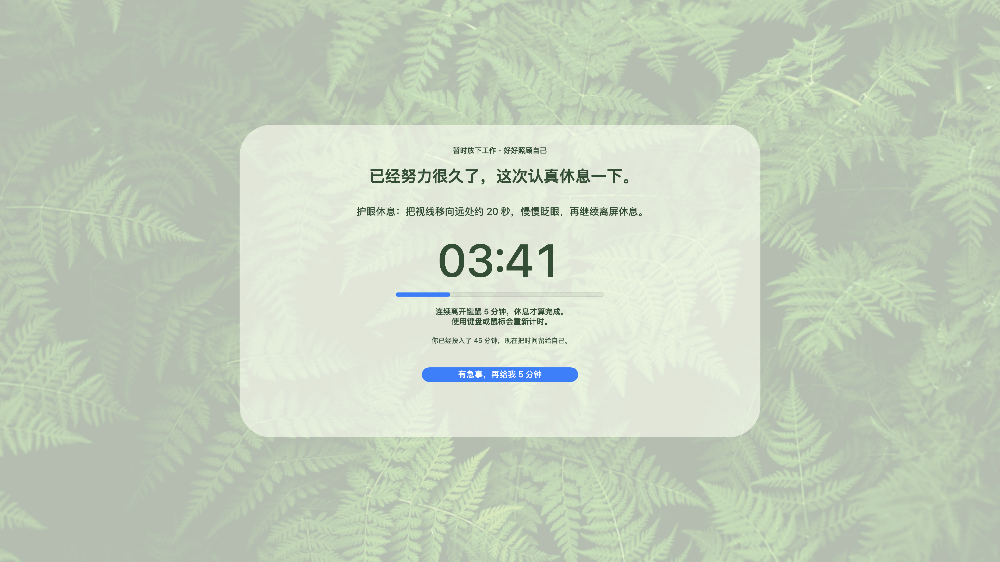
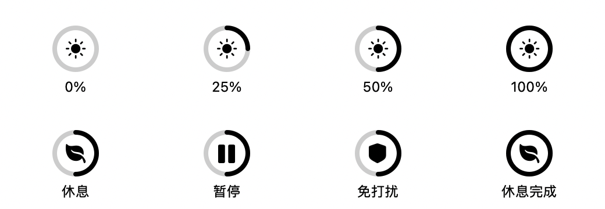
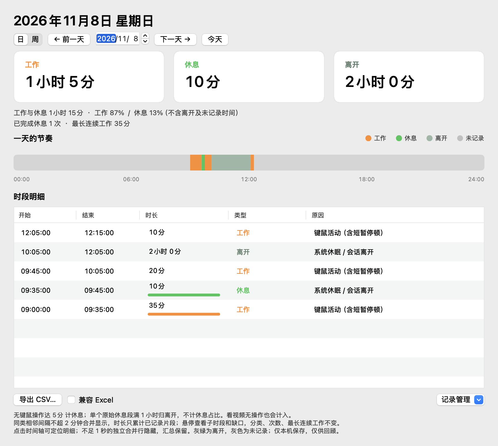
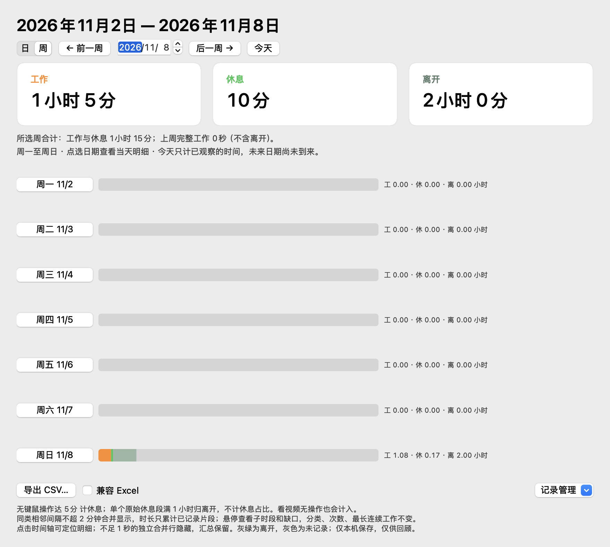
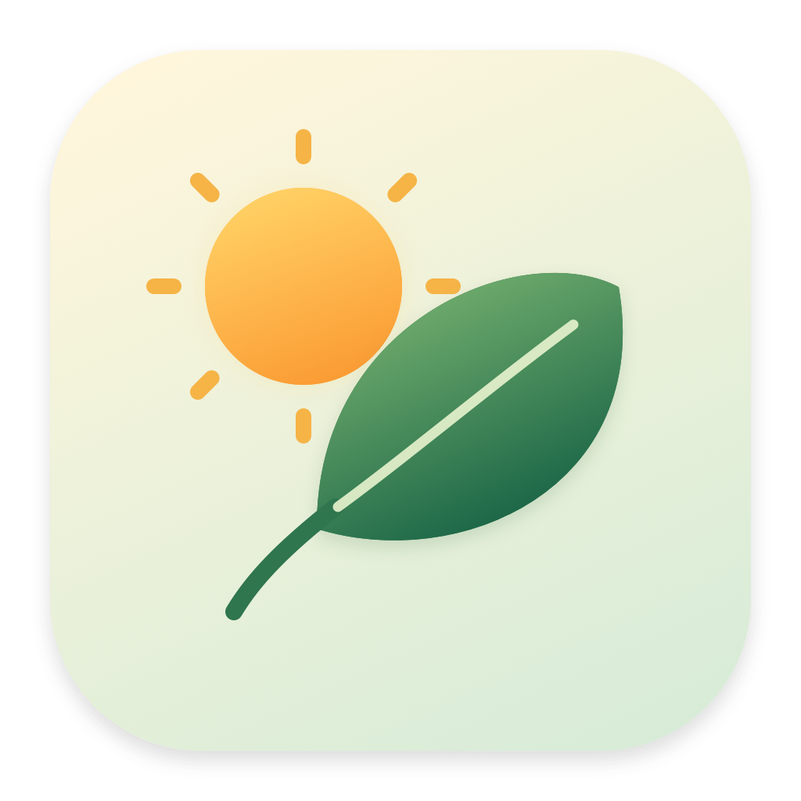
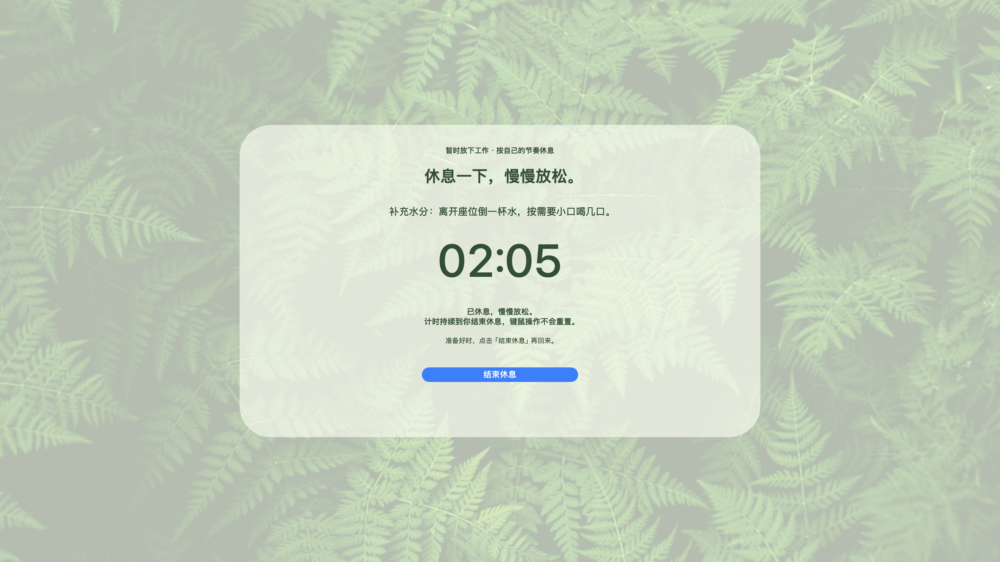
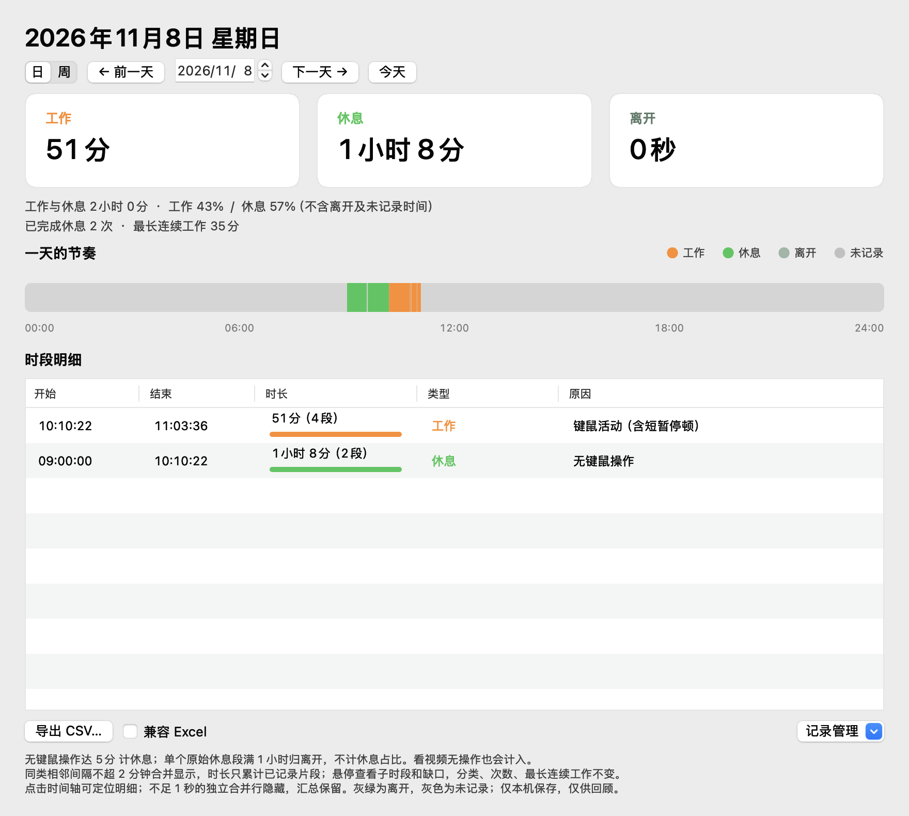
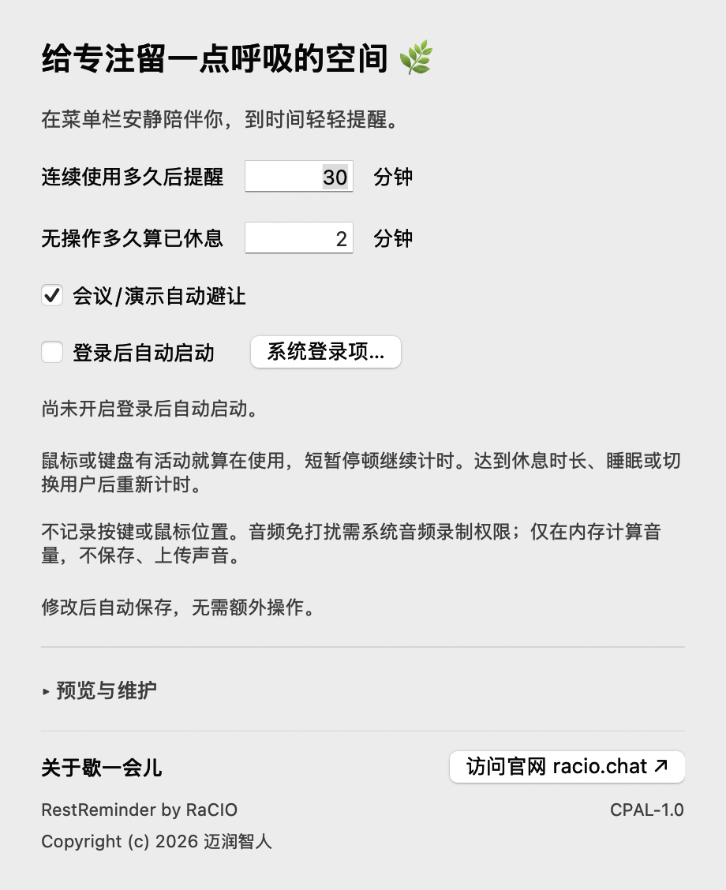

# 歇一会儿 · 产品需求文档

| 项目 | 内容 |
| --- | --- |
| 产品 | 歇一会儿 / RestReminder，原生 macOS 菜单栏休息提醒工具 |
| 需求提出者 | 项目发起人：需要长期使用 Mac 的个人用户 |
| 需求来源 | 2026-11-05 至 2026-11-09 的连续需求讨论、使用反馈和已确认方案 |
| 版本 | v1.4，2026-11-09 实现基线，增加设置关于与 CPAL-1.0 许可 |
| 状态 | 核心交互已确认并实现；公开发布事项见第 11 节 |
| 读者 | 使用者、开源贡献者、产品设计者，以及后续公众号文章读者 |
| 对应设计 | [技术设计文档](design.md) |

本文记录最终有效的产品需求，并保留重要变更的原因。历史上曾提出、后来被修改的方案，放在“迭代与决策”中，不作为当前交付要求。本文用于说明产品与验收，不代表已经完成正式开源发布。

## 阅读导航

[背景与参数](#1-背景与目标) · [功能需求](#4-功能需求总表) · [业务规则](#5-关键业务规则与验收条件) · [界面示例](#6-视觉与交互基线) · [需求追溯](#8-需求到设计的追溯) · [验收证据](#9-验收证据与尚需人工验证的部分) · [迭代过程](#10-需求演进与取舍) · [开源准备](#11-开源发布待决定事项) · [文章素材](#12-公众号文章的叙事素材)

## 1. 背景与目标

最初的需求很简单：

> “如果一直在使用，持续了一段时间（比如半个小时，这个时间是可以配置的）……就会弹出一个提示框……告诉用户需要休息了。”

使用过程中，问题逐渐变得具体：看视频时不应该被打断；锁屏休息后应该得到欢迎；短暂离开后又继续工作，需要适当劝导；提醒反复被忽略时，需要更有约束力的方式。同时，用户希望偶尔回顾一天的设备使用与休息情况。

产品目标是建立一个完整循环：**持续使用 → 温和提醒 → 识别休息 → 欢迎返回；连续忽略提醒 → 加强休息 → 保留应急出口。**

目标用户是长时间使用 Mac、希望减少久坐和连续用眼、又不希望频繁被打断的人。当前交付为本地个人工具，没有账户、云服务或订阅收费需求。

## 2. 范围、术语与参数

### 2.1 范围

当前版本包含菜单栏进度环、工作计时、温和提醒、休息返回反馈、六类建议轮换、音频及会议/演示免打扰、系统锁屏与睡眠处理、本地日/周视图、时间轴定位、长离开分类与习惯汇总、CSV 和可确认的数据清理、自动保存设置、登录自启动、三次提醒后的全屏加强休息，以及菜单主动休息正计时、正式图标、单实例、Universal 构建与自动测试配置。

当前版本不包含跨设备同步、云端分析、按应用分类的使用报告、健康诊断、真实运动识别。开源仓库与正式分发包的发布属于后续发布工作。

### 2.2 术语

| 术语 | 本文定义 |
| --- | --- |
| 输入活动 | 键盘、鼠标或触控板任一活动；不要求键盘和鼠标同时使用 |
| 空闲时长 | 距离系统最后一次输入活动经过的时间 |
| 连续工作 | 从本轮开始使用电脑起累计的时间，包含未达到休息阈值的短暂停顿 |
| 完整休息 | 连续空闲达到配置阈值，或被系统离开事件确认的足够长休息 |
| 正式提醒 | 实际显示给用户的自动休息弹窗；不含手动预览和运动提示 |
| 加强休息 | 三次正式提醒后仍未完成休息，在下一次到期时显示的全屏休息页 |
| 音频免打扰 | 实际系统音频信号存在及结束缓冲期间，抑制自动提示 |
| 工作/休息记录 | 基于设备活动的估算，不等于实际劳动时间或身体恢复情况 |
| 离开 | 整段原始休息达到 1 小时，查看时整段派生为离开，单独统计，不计入工作/短休息占比 |
| 会议/演示保护 | 部分系统元数据信号自动避让，或用户明确手动开启；不是对所有会议、专注和共享屏幕的全局识别 |

### 2.3 配置与示例的区别

| 参数 | 初始默认值 | 可配置范围 | 当前发起人使用的值 |
| --- | --- | --- | --- |
| 连续使用多久后提醒 | 30 分钟 | 0.1–240 分钟 | 30 分钟 |
| 无操作多久算已休息 | 2 分钟 | 0.1–60 分钟 | **5 分钟** |
| 普通延后 | 5 分钟 | 当前固定 | 5 分钟 |
| 加强休息应急延后 | 5 分钟 | 当前固定 | 5 分钟 |
| 升级前正式提醒次数 | 3 次 | 当前固定 | 3 次 |

全文中的“30 分钟工作 / 5 分钟休息”是发起人的配置示例，不应把代码初始默认的 2 分钟写成其实际设置。

## 3. 典型用户旅程

1. 用户打开应用，在菜单栏看到进度环图标；首次打开显示设置。
2. 用户设置工作间隔和休息时长，修改后自动保存，关闭设置后继续后台计时。
3. 达到工作间隔且正在操作时，出现温和休息提醒。
4. 用户离开键鼠并完成休息，返回操作时看到暖色摄影欢迎卡片；休息不足时，在适当场景出现运动建议。
5. 用户看有声视频时，自动提示暂缓，但本地活动记录照常进行。
6. 如果连续三次正式提醒仍未形成完整休息，下一次到期进入全屏休息页。用户完成休息，或明确选择应急延后。
7. 用户偶尔从菜单中打开记录窗口，查看当天汇总、时间轴和倒序明细。

## 4. 功能需求总表

“已确认”表示讨论中明确提出或已确认执行；“已实现”表示当前代码具备对应路径，实际平台验证范围见第 9 节。

| 编号 | 优先级 | 状态 | 使用场景、输入与输出 | 交互方式 |
| --- | --- | --- | --- | --- |
| FR-01 菜单栏驻留 | P0 | 已确认、已实现 | 打开应用后显示进度环图标与当前状态；关闭设置不退出；可主动退出 | 原生菜单 |
| FR-02 工作与休息判定 | P0 | 已确认、已实现 | 输入为空闲时长和两个配置值；输出本轮计时、是否休息完成及到期状态 | 后台自动 |
| FR-03 温和休息提醒 | P0 | 已确认、已实现 | 到期时只展示提醒，后台设置收起；“好，休息一下”立即进入绿色全屏，“5 分钟后提醒”保持延后；设置仍可从菜单主动打开 | 原生弹窗与全屏衔接 |
| FR-04 完整休息返回欢迎 | P1 | 已确认、已实现 | 达到休息时长后恢复操作，显示一次暖色太阳摄影卡片，再开始新一轮计时 | 自动、非交互卡片 |
| FR-05 休息不足运动建议 | P1 | 已确认、已实现 | 已到提醒时间或已选择休息，短暂离开又返回时，显示绿色摄影卡片和运动建议 | 自动、非交互卡片 |
| FR-06 音频免打扰 | P0 | 已确认、已实现 | 系统存在实际音频信号时暂缓自动提示；信号消失后保留缓冲；错误状态可见 | 自动判断＋状态反馈 |
| FR-07 锁屏、睡眠与返回 | P0 | 已确认、已实现 | 合并系统离开/返回事件；睡眠计入实际休息；足够长休息后解锁欢迎一次 | 系统事件驱动 |
| FR-08 本地活动记录 | P1 | 已确认、已实现 | 根据输入和系统状态记录工作/休息起止时间、类型与原因 | 后台自动保存 |
| FR-09 历史查看 | P1 | 已确认、已实现 | 选择日期后查看总时长、占比、全天时间轴和最新在前的明细 | 低频独立窗口 |
| FR-10 设置自动保存 | P0 | 已确认、已实现 | 输入合法时间后自动保存；无效输入提示并保留旧有效值；没有保存按钮 | 原生设置窗口 |
| FR-11 登录后自动启动 | P1 | 已确认、已实现 | 用户主动勾选；显示真实系统状态及待批准状态；可打开系统登录项 | 原生开关与系统入口 |
| FR-12 预览与维护收纳 | P1 | 已确认、已实现 | 三个预览和音频重连放入设置底部默认收起区域，不占一级菜单 | 展开区域＋按钮 |
| FR-13 暂停与重新计时 | P1 | 已确认、已实现 | 用户可暂停提醒或重开一轮工作计时；不删除历史、不清除未完成的提醒次数 | 菜单操作 |
| FR-14 三次提醒后升级 | P0 | 已确认、已实现 | 只累计正式提醒；前三次仍温和，下次到期转入全屏加强休息 | 自动升级 |
| FR-15 全屏连续休息 | P0 | 已确认、已实现 | 各显示器显示绿色摄影、倒计时和进度；连续空闲达标后退出 | 全屏休息页 |
| FR-16 应急延后与状态恢复 | P0 | 已确认、已实现 | 明确点击应急按钮可继续 5 分钟；保留次数及截止时间，跨短锁屏和重启恢复 | 明确按钮操作＋持久化 |
| FR-17 手动启动与分发说明 | P1 | 已确认，正式发布待准备 | 本机可运行应用；向他人提供时说明安装位置、权限、兼容性与签名公证 | 使用说明与发布包 |
| FR-18 开源与写作资料 | P1 | 已确认，文档本轮交付 | 提供可对应代码的需求、设计、演进说明与可公开截图，支持后续公众号文章 | 文档与素材 |
| FR-19 会议/演示免打扰 | P0 | 已确认、已实现（限定自动范围） | 摄像头/麦克风占用、镜像与演示全屏信号自动避让；专注/共享等场景可明确手动保护，状态未知如实呈现 | 自动信号＋菜单开关 |
| FR-20 菜单栏进度环 | P1 | 已确认、已实现 | 本轮工作从空圈到满圈，完整休息后返回工作重置；暂停、保护、休息有独立符号 | 每秒更新的原生模板图标 |
| FR-21 休息建议轮换 | P1 | 已确认、已实现 | 护眼、喝水、肩背、走动、呼吸、双手六类依次轮换；预览独立，全屏页同次建议固定 | 自动提醒与摄影卡 |
| FR-22 正式应用图标 | P1 | 已确认、已实现 | 原创暖阳绿叶图标，16–1024 像素与 icns，用于 Finder 和应用弹窗 | 原生绘制与包资源 |
| FR-23 周视图与趋势 | P1 | 已确认、已实现 | 周一至周日的三类时长、合计、上周完整工作参考；标明当前未完成日和未来日，可点回日明细 | 日/周切换与日期按钮 |
| FR-24 导出、清理与保留 | P1 | 已确认、已实现 | 导出所选日/周 CSV；删除日/周/全部前预览确认；默认永久，30/90/365 天需明确启用 | 保存面板与记录管理 |
| FR-25 时间轴定位 | P1 | 已确认、已实现 | 点击日时间轴有记录片段，选中并滚动到对应倒序明细，无额外弹窗 | 时间轴点击 |
| FR-26 兼容构建 | P1 | 已交叉构建，旧系统实机待验 | Universal 含 arm64 与 x86_64，实际最低分别 macOS 12/13；完整音频需 14.2，登录开关需 13 | 显式目标编译与部署校验 |
| FR-27 单实例 | P0 | 已确认、已实现 | 历史初始化前取得进程锁；第二实例仅转交打开窗口意图，不重复计时与写入 | 生命周期文件锁 |
| FR-28 自动测试流水线 | P1 | 已实现、本地脚本通过，远端待触发 | GitHub Actions 跑十组隔离模型测试、Universal 构建及签名/部署信息检查，生成 ad-hoc CI 工件 | push/PR/手动触发 |
| FR-29 菜单主动休息 | P1 | 已确认、已实现 | “现在就休息”打开绿色全屏正计时，不因键鼠归零、不自动结束；结束后记录时长并开始新一轮 | 菜单与全屏结束入口 |
| FR-30 同类明细合并 | P1 | 已确认、已实现 | 同类相邻且间隔不超 2 分钟合并显示段数，累计真实时长、保留缺口和子段；不改原始分类、统计或导出 | 明细分组与时间轴定位 |
| FR-31 关于与品牌署名 | P1 | 已确认、已实现 | 设置显示简短署名、“迈润智人”版权、CPAL 许可及官网按钮；小屏或维护展开后支持滚动 | 原生设置关于区域 |

## 5. 关键业务规则与验收条件

### 5.1 计时与温和提醒：FR-02、FR-03、FR-13

- 任一输入活动即可开始本轮；应用刚启动时已经存在的空闲不算一轮工作。
- 阅读、思考等短暂停顿未达到阈值时，仍包含在本轮连续使用时间中。
- 到期时如果用户正在空闲，等待恢复操作后提醒。
- 在正式提醒中点击“好，休息一下”立即进入既有绿色全屏休息页，显示当前休息阈值的连续倒计时，沿用该提醒的休息建议；不要求先累计三次，且不虚增次数。点击本身不代表完成休息，仍以连续空闲达标为准；手动预览不改变真实计时。
- 点击“5 分钟后提醒”在 5 分钟后重新判断；音乐、锁屏或暂停等更高优先级状态仍然生效。
- 暂停提醒或重新计时不删除历史。完整休息以前，累计正式提醒次数保留。

**验收例：** 工作间隔 30 分钟，期间只有数十秒空闲，应仍在约 30 分钟时进入到期状态；完整离开 5 分钟后再操作，开始新一轮。

### 5.2 返回欢迎与运动建议：FR-04、FR-05

> “休息之后回来……显示一个阳光……能增加兴奋感。”

- 完整休息后返回操作，欢迎只展示一次，含淡出约 2 秒收起（1.8 秒后开始 0.2 秒淡出）；不获取键盘焦点，不拦截鼠标。
- 解锁可以作为返回事件，兼容 Touch ID 后空闲值尚未改变的情况。
- 运动建议用于“已经应该休息但返回得太早”的场景。普通工作中的短暂停顿不触发。
- 运动建议约展示 6 秒，至少间隔 30 秒；根据实际休息配置显示分钟数，建议走走、伸展或按体力活动。
- 休息时长由空闲推断，不声称检测到了真实俯卧撑、离座或身体恢复。

### 5.3 音频免打扰：FR-06

> “检测一下，声卡是否在播放声音……不需要影响……观影。”

- 依据系统音频样本的信号强度，不以“某个进程打开了输出流”直接判定有声。
- 有声期间，自动休息弹窗、欢迎、运动建议和加强休息均应暂缓；已显示的自动提示收起。
- 声音结束后保留约 10 秒缓冲。检测刷新和信号新鲜度可使体感时间略长。
- 音乐及其他有声内容同样触发，不做内容语义分类。
- 音频期间仍记录键鼠活动。无输入达到休息阈值仍算休息。
- 被音频抑制的欢迎不排队补播，避免视频暂停后突然出现过期庆祝。
- 权限缺失、功能不支持或检测中断应显示真实错误状态，普通计时继续工作，不能永久误判为播放中。

### 5.4 系统离开与返回：FR-07

- 监听屏幕锁定、睡眠、用户会话离开及对应返回事件。
- 多种事件可能重叠，第一次离开开始挂起，全部原因解除后才处理最终返回。
- 系统离开期间不显示提示；休息计时包含合盖睡眠经过的时间。
- 足够长休息后，解锁欢迎一次；重复通知不重复欢迎。
- 短暂系统离开不清除累计提醒次数；既有工作计时在系统返回时可以重新开始，独立的应急截止时间仍保留。

**验收例：** 锁屏并合盖超过 20 分钟，唤醒与解锁通知重叠时，最终回到桌面只欢迎一次。若当时存在音频免打扰，欢迎被跳过。

### 5.5 记录和历史口径：FR-08、FR-09

> “工作的时间和休息的时间有一个对比……这个功能肯定不会频繁使用。”

- 原始档案继续记录起止时间、work/rest 类型及原因；一整段原始休息达到 1 小时，在查看时整段派生为“离开”，先分类再跨日裁剪，旧记录同样适用，归档格式不变。
- 单独汇总离开；新增已完成短休息次数（达到当前休息阈值且不足 1 小时、已结束，计入结束日期）与当天最长单段工作；进行中休息不计完成次数，最长工作包含当天已观测片段。
- 不足 1 秒的独立合并行隐藏，时间仍保留在汇总与原记录中；不跨真实异类记录合并。明细允许跨不超过 2 分钟的未记录间隔合并显示，但间隔不计时，原始统计不拼接。离开时长不使用绿色休息条。
- 视觉含义统一：工作使用太阳的暖橙色，短休息使用植物绿色，离开使用灰绿色，未记录使用灰色；汇总标题、图例、时间轴和明细类型保持一致。
- 明细时长超过当前设置阈值时，在保留文字的同时显示横向柱状条：工作按提醒间隔判断并用橙色，休息按休息阈值判断并用绿色。同类型以当天最长时段为尺度，未超出或刚好等于阈值时仅显示文字，当前进行中的时段随刷新变化。
- 空闲达到阈值后，追溯至最后一次操作时间作为休息开始；短暂停顿保留为工作。
- 锁屏、睡眠及会话离开记录休息原因；应用未运行或未观测的区间保持空白，不补造。
- 占比只以当天已记录的工作＋短休息为分母，排除离开和未记录时间，不以全天 24 小时为分母。
- 明细按开始时间**从新到旧**排列，进行中时段有标识；支持前后日期及今天。
- 记录窗口支持 Command+W 关闭，后台应用继续运行；可从菜单再次打开。
- 暂停或免打扰不暂停记录；观看视频无输入按整段时长归为短休息或离开，统计与是否允许提示是不同维度。
- 不能还原安装以前的历史；重启应用可查看旧记录，但不把退出到重启的时间自动当作工作或休息。
- 读取记录损坏时保留原文件、提示错误，避免覆盖用户数据。

### 5.6 自动保存、登录项与菜单：FR-10、FR-11、FR-12

> “不用这个保存按钮，只要用户操作了，你就自动保存就行了。”

- 输入停顿约 0.6 秒、结束编辑、关闭窗口或退出应用时保存有效时间值。
- 两个字段分别校验，无效字段保持旧有效值；实际时间值改变才重新开始本轮提醒计时。
- 登录自启动开关点击后立即申请系统变更，显示已开启、未开启、等待批准或失败；不替用户默认开启。
- 自动启动指**登录当前账户以后**，不是系统登录前启动。正常自启动安静驻留菜单栏。
- 一级菜单保留状态、会议/演示免打扰、设置、暂停、重新计时、工作与休息记录、退出。
- “预览休息提醒”“元气太阳”“运动提示”“重新连接音频检测”统一放入设置底部默认收起的“预览与维护”。

### 5.7 三次提醒后的加强休息：FR-14、FR-15、FR-16

绿色全屏有两个入口：正式提醒中主动选择“好，休息一下”立即进入；持续延后时按三次后的下一次到期自动进入。主动接受保留真实次数，应急延后或重启后继续尚未完成的绿色休息页，不重新弹出一次温和提醒。

> “反复提醒 3 次后仍不休息，就要采取相对严厉的休息方式。”

1. 前三次只累计**实际显示的自动休息弹窗**。预览、运动建议和被抑制而未显示的提醒不计数。
2. 第三次提示告知升级规则；下一次到期且用户仍在操作、没有音频或会议/演示免打扰且未暂停时，进入全屏休息。
3. 全屏覆盖当前连接的各显示器，展示连续休息剩余时间、进度和建议。
4. 普通背景点击、Escape 和普通关闭窗口动作不收起页面。系统正常快捷键保留，应用不是系统锁屏或不可绕过的管控软件。
5. 停止操作后累计连续空闲，新输入使休息倒计时重新开始。时长跟随设置，发起人当前为 5 分钟。
6. 完整休息后收起页面，次数清零；恢复操作时展示一次欢迎。
7. “有急事，再给我 5 分钟”收起页面并尝试返回原工作应用，不清零次数，到期后重新判断加强休息。
8. 应急截止时间独立保存，短暂锁屏、采样间隔、改时间或重启不能把它误变为一整轮工作间隔。
9. 处于加强休息时退出后再次启动，未完成状态在恢复操作时继续；累计次数和应急截止时间均保存在本机。
10. 音频或会议/演示免打扰、暂停、锁屏期间收起全屏提示；隐藏期间真正完成休息，仍应解除本轮升级。

**时序示例：** 持续操作，30 分钟出现第 1 次提醒；选择延后；35 分钟第 2 次；40 分钟第 3 次；45 分钟进入加强休息。该例假设每次都选固定 5 分钟延后，期间没有完整休息或其他抑制条件。

### 5.8 会议与演示保护：FR-19

- 默认启用自动避让，仅以公开系统元数据作为信号：摄像头/麦克风报告占用、镜像投屏、前台 Keynote/PowerPoint 屏幕大小窗口。没有打开设备、录制音视频或截屏。
- 信号结束后缓冲 10 秒；与音频免打扰取或，抑制普通自动提醒、欢迎、运动建议和加强休息，保留工作计时、记录与未完成次数。隐藏时真正完成休息仍清零。
- 这些信号不能完整识别所有会议，满屏演示编辑窗口也可能触发。系统专注、浏览器演示、共享屏幕等覆盖不足时，菜单提供“开启会议/演示免打扰”，持续到手动结束，跨应用重启保留。
- 设置可关闭自动避让；菜单显示原因和边界，未知不冒充已保护。当前版本不声称自动跟随全局系统专注状态。

### 5.9 菜单栏进度环：FR-20

- 正常工作时按本轮时间/当前工作间隔从空圈填满；到期及普通延后保持满圈，完整休息后恢复工作从空圈开始。
- 中心太阳代表工作，叶子代表休息；暂停时为暂停符号，音频或会议保护时为盾牌。暂停/保护优先显示，避免看起来仍在正常提醒。
- 休息状态按连续键鼠空闲/休息阈值显示，普通未达阈值短暂停顿仍保留工作进度。加强休息出现新输入时休息环重新从零计算。
- 每秒刷新，悬停可看状态；使用原生模板色适配菜单栏明暗外观，不增加常驻数字文字。

### 5.10 轮换建议与正式图标：FR-21、FR-22

- 六类建议按固定次序轮换，下一位置保存在本机；手动预览使用独立轮换，不推进自动序列。欢迎卡仍保持暖阳摄影和原欢迎语。
- 普通提醒、休息不足摄影卡和加强休息使用轮换建议。同次加强页在每秒倒计时和显示器变化时保持同一条建议，不闪换文案。建议不替代完整休息阈值。
- 正式图标为原生矢量路径绘制的暖阳绿叶，提供 16–1024 像素与 icns；菜单栏仍是原来的动态进度环。

### 5.11 周视图与时间轴联动：FR-23、FR-25

- 以本地周一至周日为一周，汇总工作、短休息、离开，并展示七天的同口径色条。当前日标明截至目前，未来日不计入已完成时间且不可点入。
- 展示上周完整工作时间作参考，明确当前周可能未完成，不计算容易误解的增长百分比。没有记录的时段不补成工作或休息。
- 点击周内日期返回该日日视图；点击日时间轴的有记录色块，选中并滚动到对应倒序明细。保留 Command+W 和日期导航。

### 5.12 导出与数据控制：FR-24

- 保存面板导出当前日或周的 UTF-8 CSV，含带时区的精确起止时间、秒数、work/rest/away、原因与进行中状态；包括界面隐藏的亚秒正数片段。可选“兼容 Excel”添加 BOM。CSV 正确处理逗号、引号、换行和可能成为表格公式的前缀。
- 删除当前日、当前周或全部历史前，展示实际影响的原始时段数、时长、范围、保留片段及最新观察截点。默认按钮是取消；截点后的新记录保留，清除时间不会被空闲回溯补回。
- 原始 work/rest v1 档案保持可读；删除或保留期限切分时段后，范围外片段分别保留，按保留片段长度重新判断短休息/离开，确认界面明确说明。
- 默认永久保留。30/90/365 天按当前本地时间向前推算，启用前预览并确认；随后随保存自动清理。取消或失败不改变旧设置，启动加载本身不清理、不重写档案。
- 先原子写入成功，再提交内存修改；失败保留旧记录。无法读取/不支持的原档案禁止覆盖性清理。测试只使用内存或临时档案，不删除真实历史。

### 5.13 兼容、单实例与自动测试：FR-26–28

- 本轮实际交叉构建得到 arm64 / macOS 12.0 与 x86_64 / macOS 13.0 两个 slice，并合成 Universal；最低系统版本按二进制和架构专用清单核验，不能仅修改清单数字。
- macOS 14.2 以下不提供实际音频自动检测，可用手动保护；macOS 12 的登录自启动通过系统用户与群组手动添加，macOS 13 及以上保留原生开关。Intel、旧系统、投屏和真实会议仍需相应设备验证。
- 在创建历史模型前取得当前用户的进程锁；第二实例只激活原实例或转交打开记录/设置，不打开另一套记录器。进程退出或崩溃由系统释放锁，不删除锁文件造成竞争。
- GitHub Actions 配置十组隔离模型测试、Universal 构建与部署/签名校验，输出明确标记为 ad-hoc 的 CI 包。本地通过不等于远端已执行，不自动发布 Release。

### 5.14 待定项与配置讨论

到期前一分钟预告仍待定，不在本轮实现。提醒策略的高级设置仍是讨论方案：普通延后 1–30 分钟（默认 5）、温和提醒 1–5 次（默认 3）、应急延后 1–15 分钟（默认 5）。建议已经开始的延后保持原截止时间，次数变更从完整休息后的新一轮生效，始终保留应急出口。用户未确认前，不增加这些控件、不改变实际 5 分钟 / 3 次 / 5 分钟规则。

### 5.15 菜单主动休息：FR-29

- 菜单提供“现在就休息”，立即开启同一绿色摄影全屏页，按包含睡眠的单调时钟显示已休息时长。超过一小时显示时分秒，无目标进度、无到时自动结束。
- 点击“结束休息”或菜单同名项结束并重新开始工作计时；移动键鼠不重置主动时长。到期提醒后的绿色页仍使用原来的连续空闲倒计时与应急延后。
- 主动区间以“主动休息”原因写入原 v1 rest 记录。锁屏/睡眠只隐藏页面，回到桌面继续正计时；退出应用即关闭记录，重启不恢复正计时、不补记退出期间。
- 暂停及音频/会议免打扰继续控制自动提醒；主动入口属于明确用户操作，可在这些状态下使用，不自动关闭原开关。设置不随全屏抬起。
- 不增加正式提醒次数；旧未完成提醒仅在实际连续空闲或系统离开达标后清零。历史仍沿用原有短休息/长离开、比率和保留期限规则。

### 5.16 相邻同类明细合并：FR-30

- 默认将相邻同类、间隔不超过 2 分钟的原始片段合并成一行，例如“51分（4段）”。不跨日期、异类片段或更长间隔；不同原因保留在组内。
- 时长只累计已记录的成员，不能以首尾相减补入空白。悬停可看所有原始时段及缺口；时间轴仍保留缺口，点击任何成员都选中合并行，未记录间隔不可选成记录。
- 进行中状态来自实际当前成员，即使其本身不足 1 秒也可标明合并行进行中。先按所有正数片段分组，最后隐藏累计不足 1 秒的组；隐藏异类片段仍阻止越过它合并。
- 分组只是呈现。原始 v1 档案、CSV、汇总、删除/保留预览、已完成休息次数、最长连续工作及单段达到一小时归离开的规则不变；多个短休息的合计超过一小时不会被重新改计离开。

### 5.17 关于与品牌署名：FR-31

- 菜单“设置…”中的“关于歇一会儿”保留标题、官网按钮、简短署名和许可版权；不另列品牌大标题、公司全称或业务简介。
- 明确显示“RestReminder by RaCIO”、CPAL-1.0 和“Copyright (c) 2026 迈润智人”；官网按钮只在用户点击后打开 https://www.racio.chat，初始化或计时不访问网站。
- 设置按内容高度和当前屏幕可见区域调整；小屏或展开维护工具后可纵向滚动，不裁切关于或原有设置。
- 署名使用许可证 Exhibit B 指定信息；不新增启动广告、计时广告或自动打开官网。

## 6. 视觉与交互基线

### 6.1 欢迎：暖色摄影、无边框

最终采用太阳星芒和层叠山影的实拍照片，配暖金、奶油色光感和深棕文字。照片直接铺满圆角卡片，不保留彩色描边、边线或大面积黑色遮罩。保留轻微淡入缩放及少量漂浮光点；系统开启“减少动态效果”时取消缩放和漂浮光点，保留淡入淡出。

### 6.2 运动建议：清新绿色、同系列摄影

采用高清蕨叶照片、薄荷色光感和深绿色文字；移除幼苗大图标，保持无边框、通透、完整文案可读。

### 6.3 加强休息：全屏、明确倒计时与出口

延续绿色摄影，使用大号等宽数字倒计时、进度条和始终可见的应急按钮。重视文字对比度、键盘可用性和退出后恢复工作焦点。

### 6.4 进度环与三类统计（日视图）

菜单栏工作环从空到满，休息、暂停、保护使用不同中心符号：

记录窗口分列工作、短休息和离开，展示完成休息次数与最长单段工作：

### 6.5 周视图（模拟数据）

七个本地日的三类时长与周汇总；点击日期可回到日明细：

### 6.6 正式应用图标

原生绘制的暖阳和绿叶图形，用于 Finder 和应用包；不替换菜单栏动态进度环：

以上图片为独立测试进程渲染的界面示例，包含演示倒计时和演示工作分钟数，不是发起人的真实使用统计。摄影来源与使用说明见[素材记录](../Resources/PHOTO-CREDITS.md)。

### 6.7 主动休息正计时

菜单主动休息沿用绿色摄影；模拟已休息 2 分 5 秒，没有目标进度，结束由用户决定：

### 6.8 合并明细（模拟数据）

六个原始时段合并为两行；休息合计一小时多仍保留两次原始休息的分类与次数，缺口不补计：

### 6.9 设置关于与品牌

该示例不读取真实设置或历史。官网仅在按钮点击后访问，默认后台计时仍保持本地运行。

## 7. 非功能需求

| 编号 | 需求 | 验收边界 |
| --- | --- | --- |
| NFR-01 原生与轻量 | Swift / AppKit 菜单栏应用，使用系统框架，无第三方运行依赖 | 不占常驻 Dock 图标；关闭设置仍运行 |
| NFR-02 本地隐私 | 不记录按键内容或鼠标位置；数据本地保存，运行时不联网 | 音频样本只在内存计算信号，不存音频、不上传、不做语音识别 |
| NFR-03 权限透明 | 准确音频检测需要系统音频录制权限，功能不可用时如实提示 | 拒绝授权不影响基础提醒，不伪装正常或一直有声 |
| NFR-04 状态可靠性 | 系统事件重叠、长采样间隔和音频状态切换不能重复欢迎或遗留全屏页 | 模型测试覆盖；真实平台组合需人工验收 |
| NFR-05 数据保护 | 原子保存、损坏文件保护，不生成未观测的历史 | 异常退出的最近未保存区间可能丢失，当前检查点约 30 秒 |
| NFR-06 可访问性 | 非交互卡片不夺焦点，尊重减少动态效果；全屏应急按钮可键盘操作 | 正常系统快捷键可用；不安装全局输入拦截 |
| NFR-07 可维护性 | 规则模型与原生窗口分离，提供确定性测试和素材来源 | 开源贡献者可定位需求到代码及测试 |

本版本没有经过量化的 CPU、内存或续航基准测试，因此不写“零耗电”等承诺。

## 8. 需求到设计的追溯

| 需求 | 对应设计主题 | 主要实现 |
| --- | --- | --- |
| FR-01、FR-03、FR-10–13 | 菜单、设置、普通弹窗与登录项 | [应用编排](../Sources/main.swift) |
| FR-02、FR-04、FR-05 | 连续工作、休息、返回反馈 | [计时状态机](../Sources/ActivitySession.swift) |
| FR-06 | 实际音频信号、新鲜度与结束缓冲 | [音频检测](../Sources/AudioPlaybackMonitor.swift) |
| FR-07 | 系统离开原因集合与最终返回 | [计时与系统状态](../Sources/ActivitySession.swift)、[应用编排](../Sources/main.swift) |
| FR-08、FR-09 | 记录分段、持久化、日切片、倒序明细 | [历史模型](../Sources/ActivityHistory.swift)、[历史窗口](../Sources/HistoryWindow.swift) |
| FR-04、FR-05、NFR-06 | 摄影反馈、淡入淡出和非激活面板 | [返回反馈](../Sources/ReturnCelebration.swift) |
| FR-14、FR-16 | 三次计数、应急截止时间、完整休息清零 | [升级策略](../Sources/RestEscalation.swift) |
| FR-15、FR-16 | 各屏全屏窗口、倒计时、应急出口 | [加强休息窗口](../Sources/StrongRestWindow.swift) |
| FR-17、FR-18 | 构建、素材声明与公开文档 | [构建脚本](../build.sh)、[技术设计](design.md) |
| FR-19 | 自动信号、范围提示、手动持续保护 | [会议保护](../Sources/PresentationProtection.swift)、[应用编排](../Sources/main.swift) |
| FR-20 | 进度计算、状态符号与模板绘制 | [菜单栏进度环](../Sources/StatusProgressRing.swift) |
| FR-21 | 六类建议、独立预览与自动轮换 | [建议序列](../Sources/RestAdvice.swift)、[摄影卡](../Sources/ReturnCelebration.swift)、[全屏页](../Sources/StrongRestWindow.swift) |
| FR-22 | 原生原创图标生成与包资源 | [绘制脚本](../scripts/GenerateAppIcon.swift)、[1024 像素图标](../Resources/AppIcon.png) |
| FR-23–25 | 周统计、导出、事务清理、时间轴定位 | [历史模型](../Sources/ActivityHistory.swift)、[历史界面](../Sources/HistoryWindow.swift) |
| FR-26 | 显式架构目标、部署信息与签名检查 | [构建脚本](../build.sh)、[睡眠兼容时钟](../Sources/RestContinuousClock.swift) |
| FR-27 | 生命周期进程锁与意图转交 | [单实例](../Sources/SingleInstanceGuard.swift)、[应用入口](../Sources/main.swift) |
| FR-28 | 十组隔离测试及 Universal CI | [本地测试入口](../scripts/test.sh)、[GitHub Actions](../.github/workflows/tests.yml) |
| FR-29 | 菜单主动入口、正计时、明确结束与历史归档 | [主动状态](../Sources/VoluntaryRest.swift)、[应用编排](../Sources/main.swift)、[双模式全屏](../Sources/StrongRestWindow.swift) |
| FR-30 | 同类细节分组、真实累计、成员定位与透明缺口 | [分组模型](../Sources/ActivityHistory.swift)、[明细呈现](../Sources/HistoryWindow.swift)、[模型测试](../Tests/HistoryTests.swift)、[窗口验证](../Tests/HistoryWindowSmoke.swift) |
| FR-31 | 设置关于、点击官网及可变高滚动 | [关于组件](../Sources/AboutBrandView.swift)、[设置集成](../Sources/main.swift)、[原生界面验证](../Tests/AboutBrandSmoke.swift)、[署名附件](../LICENSE) |

完整状态流转、数据结构和测试命令见[技术设计文档](design.md)。

## 9. 验收证据与尚需人工验证的部分

截至本基线，已经通过计时、音频离线信号与抑制、历史存储、锁屏返回、升级策略测试；已经渲染摄影反馈和原生全屏休息页，并验证应急按钮回调、普通关闭不退出、当前连接显示器的覆盖。构建及本机签名校验通过，应用已启动。

以下应在公开版本发布前人工验证，不用单元测试结果替代：

- 真实锁屏、合盖、Touch ID，以及多个显示器与不同全屏 Space 的组合。
- 完成系统授权后的真实视频/音乐、耳机和外接音频输出行为。
- 原生登录项批准、实际注销或重启后的自动启动。
- 在目标 macOS 版本和芯片上的安装、首次权限、连续运行和应急返回。
- 真实长时间使用。30/35/40/45 分钟是确定性时间模拟结果，并非本轮真实等待 45 分钟的录像证据。

v1.2 验证补充：十组隔离模型测试通过，覆盖原计时/音频/锁屏/升级、历史周统计和事务数据操作、会议信号、进度环、建议轮换与临时目录的跨进程锁竞争/崩溃恢复。原生窗口验证通过日/周切换、七日入口、时间轴选中滚动、取消删除/清空/保留期限、Command+W，以及两种窗口尺寸下的布局；摄影卡和加强页渲染通过。Universal 两个架构的实际部署信息和 ad-hoc 签名校验通过。

本机真实用户目录的额外命令行二次启动探测被工作区文件沙箱拒绝，已停止，不计作互斥通过证据；互斥证据来自隔离临时目录的真实多进程测试。GitHub 远端、Intel 硬件和旧系统运行尚未实测，真实保存面板选址及数据删除由用户明确操作。

## 10. 需求演进与取舍

| 阶段 | 用户反馈或新场景 | 最终决定 |
| --- | --- | --- |
| 起点 | 半小时后温柔提醒 | 时间可配置，菜单栏驻留 |
| 正反馈 | 休息回来希望有阳光和兴奋感 | 返回欢迎一次，足够休息后再开新轮 |
| 短休息 | 回来太早仍需要运动建议 | 到期/已选休息场景触发，保留冷却 |
| 观影 | 看视频不希望被打断 | 依据实际音频信号免打扰 |
| 静音误报 | 没有声音却一直显示播放 | 放弃仅看输出流是否运行，改用信号强度 |
| 回顾 | 偶尔想看工作与休息对比 | 低频记录入口、时间轴、倒序明细、本地存储 |
| 锁屏缺失 | 锁屏休息二十多分钟回来没有太阳 | 显式锁屏监听、睡眠时间、重叠通知去重 |
| 设置摩擦 | 不希望点击保存 | 输入有效值后自动保存 |
| 菜单负担 | 四个低频动作不放一级菜单 | 收入默认折叠的预览与维护 |
| 视觉升级 | emoji 呆板，希望摄影氛围 | 暖阳摄影及清新绿色摄影 |
| 视觉修正 | 黑色太多、边框太明显 | 移除描边与外圈，改为通透暖色光感 |
| 提醒无效 | 三次提醒后仍不休息 | 下次到期全屏、连续休息、可应急延后 |
| 公开沉淀 | 希望开源并写成公众号文章 | 需求与设计相互对应，保留真实演进和验证边界 |

## 11. 开源发布待决定事项

源码许可与署名已确认；目标设备验收、正式签名公证及远程发布仍单独跟进。

### 11.1 源码许可证：已采用 CPAL-1.0

- 原创源码采用 [CPAL-1.0](../LICENSE)，正文第 1–15 条保持标准文本，Exhibit A 填写项目与开发者身份，Exhibit B 指定有限品牌署名。
- 权利主体见 Exhibit A；Exhibit B 的版权展示名为“迈润智人”，署名短语为“RestReminder by RaCIO”，网址为 https://www.racio.chat；对 Larger Works 同样要求署名，不额外指定图形。
- 原版以设置中的“关于歇一会儿”提供署名及官网入口。界面归属、源码提供与外部部署义务依许可证第 3、14、15 条执行，不要求完整保留公司业务宣传文案。

第三方摄影素材继续遵循其独立许可与来源记录，不因源码采用 CPAL 而重新授权。

### 11.2 首次发布的平台范围：待维护者决定

- [ ] **Apple Silicon＋选定系统版本**：首轮测试面较小，需要显式构建部署目标。
- [ ] **Universal＋更广系统范围**：覆盖更多用户，需要两个架构及更多设备验收。

目前实际 Universal 二进制包含 arm64/macOS 12 与 x86_64/macOS 13 部署目标，并已核对切片、最低系统和本地签名；旧系统与 Intel 实机仍待验收。完整音频检测依赖 macOS 14.2+。首发范围应与实际设备验证保持一致。

### 11.3 分发形式：首发公开源码

- [x] **先公开源码与自编译说明**：已确认首发 v1.0.0；[GitHub 主仓库](https://github.com/xiongwhu/RestReminder) 与 [Gitee 源码镜像](https://gitee.com/dukexls/RestReminder) 均公开，分支与附注标签已核对一致。
- [ ] **后续提供签名、公证后的下载包**：不在本次首发范围，需要开发者证书、目标平台验收及打包发布流程。

首发采用 CPAL-1.0 与 Exhibit B 指定署名，不发布二进制试用包。维护者同步 main 与版本标签，首次导入不代表自动同步。当前没有约定商业收费、合作费用或交付报价。

## 12. 公众号文章的叙事素材

建议把文章写成一个真实使用场景驱动的产品迭代故事，而不是功能堆砌。可用的结构是：

1. **起因**：只是想让 Mac 在连续使用半小时后提醒自己休息。
2. **第一个完整循环**：提醒、休息、回来时的正反馈。
3. **真实使用暴露问题**：静音输出流误报、锁屏二十多分钟没有欢迎。
4. **交互逐渐变轻**：自动保存、低频操作折叠、本地记录。
5. **审美迭代**：太阳图标到摄影，深色和描边到暖色无边框，再统一绿色运动提示。
6. **让提醒有分量**：三次后加强休息，仍保留应急出口。
7. **开源时公开什么**：规则、代码、测试、素材来源与真实限制。

候选标题：**《我给 Mac 做了一个休息提醒工具，也给自己留了一个应急出口》**。此标题是写作建议，不代表文章已完成或已经发布。

可直接使用本文件中的十张界面/图标示意图。历史记录截图应使用明确标注的模拟数据，避免公开个人日常作息。可引用本文件已摘录的需求原话；不应声称“完全不需要音频权限”“兼容所有 Mac”“能准确测量工作效率”或“照片实拍于早上八九点”。

## 13. 后续行动

本次交付需求文档、对应技术设计和可公开的界面示例。源码许可和公开署名已按 CPAL-1.0 落实；维护者下一步确认首发平台与分发形式，完成目标设备人工验收，整理仓库并发布。公众号文章可基于第 10–12 节及技术设计中的关键决策展开。
